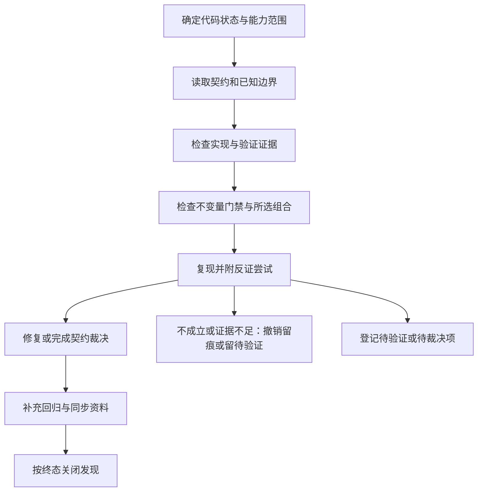

# AspectN 使用文档、Agent 知识库与能力审查体系设计讨论稿

- 日期：2026-10-11；2026-10-12 经多模型讨论（§14、§16）、Codex 独立评审（§15）与维护者裁决（§17）后修订
- 状态：正文已按维护者裁决修订；落地实施尚未启动
- 目的：保存设计思路，供维护者和其他 reviewer 讨论
- 范围：用户文档、Agent 知识库、能力证据与 code review 流程

本文提出的是文档与工程流程设计，不构成新的 AspectN 语言契约，也不授权改变现有实现、公共 API 或兼容性行为。下文目录、能力编号、模板和自动化规则中，标注「已裁决」的条目经维护者批准（裁决表见 §17），其余仍为建议。

## 1. 背景与问题

AspectN 已经历多轮 code review，仍持续发现新的问题。希望通过更完整、结构清晰的文档和知识库，让 review 具有明确范围、共同依据和可积累的结果。

持续发现新问题不能直接证明文档是唯一原因。可能的原因还包括：功能组合覆盖不足、适配器差异、输入条件不明确、测试夹具不能代表真实输入，以及审查范围和完成条件缺少定义。

仓库已有语言规范、语言指南、设计决策、专题说明、迁移说明和多轮 review 记录。新体系应优先整理和关联已有资料，减少重复定义及其造成的漂移。

## 2. 目标与基本原则

### 2.1 目标

1. 为 AspectN 用户提供能够完成实际任务的使用文档，明确功能、用法、不支持的部分和常见坑。
2. 为 AI Agent 提供按 .NET/C# 功能组织、遵循渐进式披露原则的知识库。
3. 让每项能力承诺、已知限制和 review 结论具有可追溯的规范及验证证据。
4. 使每轮 review 的发现持续完善知识库和回归覆盖，逐步收敛能力边界。
5. 通过 AGENTS.md、变更说明和适量自动检查，保持代码、规范、知识库与用户文档同步。

### 2.2 原则

- 知识库是审查入口和证据索引。确定的结论必须能够追溯到批准的规范、适用条件及验证证据。
- 文档声明不等于实现已经正确；测试通过也不等于覆盖了所有输入。
- 当前实现行为不自动成为设计契约。发现冲突后，需要区分实现缺陷、规范缺口和待裁决的行为变化。
- 未验证、不支持、输入信息不足和运行时 Unknown 是不同概念。
- 使用文档与知识库面向不同读者，但共享规范依据和能力条目，避免复制一套独立规则。
- 已批准的语言规范继续定义语言与公共契约；历史 review 和记忆工具提供背景及检索线索。
- 按风险扩展验证，不以穷举全部 .NET/C# 功能组合为完成条件。

## 3. 文档职责与依据关系

| 资料 | 主要读者 | 回答的问题 | 维护重点 |
| --- | --- | --- | --- |
| 用户使用文档 | AspectN 用户 | 怎样完成我的任务？ | 可运行示例、推荐用法、限制、诊断和排错 |
| Agent 知识库 | AI Agent、维护者、reviewer | 这项能力承诺什么，边界在哪里，如何验证？ | 精确规则、条件、原因、实现入口与证据 |
| 正式规范 | 所有实现与审查参与者 | 批准的语言及公共契约是什么？ | 契约、兼容性和设计裁决 |
| 测试与验证记录 | 维护者、reviewer | 哪些场景已经被证明，在哪些环境下？ | 独立预期、复现、运行环境和代码状态 |
| Review 历史、Memorix | 维护者、Agent | 过去发生了什么，为什么作出决定？ | 背景、检索和历史，不代替当前正式契约 |

同一主题应有明确的正式规范来源。知识库通过引用及解释组织规范；用户文档通过任务和示例组织使用方式。新裁决落入正式资料后，历史记录应能指向其当前结论。

文档冲突需要记录并解决，不应由 Agent 任意选择一个版本作为依据。旧计划和历史比较文档应明确其适用范围及被哪些新裁决取代。

规范效力与冲突处理（已裁决，见 §17）：当前有效条款由批准状态、适用范围与显式 supersedes 关系确定。被规范正文委托的专题文档（如 metadata-availability.md、array-shape.md）在委托范围内即正式规范；docs/language/ 下的资料须逐文件、必要时逐条款登记地位，不批量认定为规范附录。未显式声明取代关系的冲突一律登记待维护者裁决，登记期间不单方择一、受影响结论标注「待裁决」且不得写入用户文档承诺；无冲突时按正文与委托附录的日常分工执行。不设文件级固定优先链。

## 4. 用户使用文档设计

用户文档建议涵盖以下内容：

- 产品定位：表达式解析和元数据匹配的职责，与调用方筛选、织入或其他操作的边界。
- 安装和适配器选择：Core、Cecil、Cecil.Fody、Roslyn、Reflection 的用途、依赖及兼容性注意事项。
- 快速开始：编译表达式、获取编译结果、映射候选对象、执行匹配、读取诊断。
- 按任务组织的指南：匹配类型、方法、构造函数、属性访问器、泛型、参数和 attributes。
- 表达式参考：selector、通配符、泛型子句、变量、组合与否定、regex。
- 结果处理：Matched、NotMatched、Unknown，以及显式布尔转换策略。
- 不支持的功能及替代办法：准确说明限制所属的层次，避免泛泛写成“完全不支持”。
- 常见坑：语法与 C# 直觉的差异、元数据不足、适配器输入差异、资源限制和生命周期。
- 诊断与排错：诊断码、典型原因、如何确认缺失信息、何时修复调用方式。
- 版本与迁移：已批准的行为变化、破坏性变化和迁移示例。
- 公共 API、对象生命周期与性能契约：TypeSystem 复用、LeaveOpen、缓存与哈希稳定性等跨调用约束。

示例应尽量可编译或可作为表达式测试执行。用户文档不必暴露大量实现细节，但用户需要据此作出选择的条件和限制必须可见。「元数据不足」作为排错指导呈现，不表述为静态能力不支持。用户指南按章节声明覆盖的能力编号，行为性陈述（支持、限制、诊断）须可追溯至对应条目，叙述性内容不要求逐句挂编号。

## 5. Agent 知识库设计

### 5.1 渐进式披露

建议在 docs/knowledge/ 下建立三级阅读路径，具体目录名待讨论：

| 层次 | 建议入口 | 内容 | 加载时机 |
| --- | --- | --- | --- |
| 总入口 | index.md | 项目范围、依据关系、能力索引和审查路由 | 开始任务时 |
| 分类摘要 | 各分类的 index.md | 能力表、关键边界、关联功能和审查关注点 | 判断影响范围时 |
| 能力详情 | 单项能力文档 | 精确规则、例子、原因、实现入口和证据 | 修改或审查该能力时 |

能力详情的开头先给出结论、适用条件、关键例外和证据状态，再展开细节。入口文档避免重复所有条目全文，也不要求 Agent 每次读取整个知识库。

### 5.2 分类建议

以 .NET/C# 功能作为主要入口，以下是待盘点的候选分类。出现在目录中不表示该功能已受支持。

| 分类 | 候选主题 |
| --- | --- |
| 类型与身份 | 类型名称、命名空间、嵌套类型、程序集身份、类型转发、结构比较 |
| 泛型 | arity、开放与构造类型、泛型参数声明身份、闭合上下文、约束、模式变量、variance |
| 类型使用位置 | 数组形状、nullable、tuple、by-ref/ref-kind、指针、函数指针、custom modifier |
| 成员 | 普通方法、构造函数、属性和索引器、访问器、事件、运算符和转换、显式接口实现、编译器生成成员 |
| C# 编译表示 | async、iterator、partial、源码与 PE 的差异、源码特征和元数据事实的关系 |
| Attributes | 直接记录、目标位置、编译器标记、合成信息、读取失败和集合可用性 |
| 解析与词法 | 字符与 token 规则、邻接要求、语法结构、转义扫描、恢复边界、解析阶段诊断与深度限制 |
| 绑定与匹配语义 | selector 语义、通配符、逻辑组合、否定、赋值关系查询、变量作用域、泛型子句语义、三态结果 |

分类裁决（见 §17）：增设「解析与词法」一级分类（编号前缀 SYN-），原「语言与匹配」重定为「绑定与匹配语义」。regex 的表达式扫描与语法子集归解析与词法，运行时匹配、超时与结果归绑定与匹配语义；规范签名文本作为中立签名的格式化契约独立成条目，由相关分类引用。一个条目只设一个主要归属，跨层缺陷按所违条款归类并可关联多个条目；稳定编号不与物理目录绑定，移动条目不改编号。

另外提供横向入口，覆盖三态逻辑、缺失元数据、诊断、取消、资源限制、缓存、对象生命周期、公共 API 和包兼容性。

### 5.3 每项能力的维度

每项能力分别描述：

1. C# 语法、CLI/元数据事实或契约阈值（横向主题适用）。
2. AspectN DSL 能否表达，以及表达方式。
3. 中立签名模型能否保留相关信息。
4. 核心语义如何使用这些信息。
5. Cecil、Cecil.Fody、Roslyn、Reflection 的能力及差异。
6. 输入条件：源码 symbol、编译后 PE、原生关联对象、detached signature、未解析引用等；单次输入充足性在此声明，只影响当次查询结果与诊断，不改写静态契约状态。
7. 适用版本、限制和验证状态。

不能用单个“支持/不支持”替代这些维度。尤其需要区分“模型能保留信息”和“DSL 能选择该信息”。结果按阶段记录：解析、原生映射、匹配与调用方转换各阶段的异常、诊断与三态分别描述（如原生 mapper 超限抛 AspectNLimitException，中立签名匹配超限返回 Unknown），不概括为单一结果状态。

## 6. 能力条目与证据模板

建议使用稳定编号，例如 GEN-IDENTITY-001、REF-CLASSIFICATION-001。编号规则（已裁决冻结）：前缀与 §5.2 分类一一对应并公布映射，不依赖文件路径或源代码行号。一项能力定义为「可独立承诺、可独立证伪的最小单元」，七个维度归入条目内描述，不拆成七倍条目。

| 字段 | 内容 |
| --- | --- |
| 编号、标题、分类 | 稳定标识及所属功能 |
| 摘要 | 结论、适用条件与关键例外；状态由下列字段派生显示，摘要不是权威来源 |
| 契约状态 | 支持、明确排除、待裁决；按适用条件与分层能力记录，不因实现缺陷改写 |
| 验证状态 | 未验证、已验证、待重验、验证失败；已验证注明覆盖场景，验证失败附结果与归因（产品或环境） |
| 验证方式 | 自动测试、手动核对或两者组合 |
| 契约 | 精确语义、前置条件、成立的不变量 |
| 分层能力 | DSL、模型、核心与各适配器分别支持到哪里 |
| 示例 | C# 或元数据输入、AspectN 表达式、预期状态及诊断；正例与反例，对外承诺条目反例必填；可由真值表、属性测试或诊断测试承载 |
| 限制与原因 | 限制所属层次、具体原因、设计依据、可用替代方式 |
| 失败表现 | 编译诊断、映射异常、NotMatched、Unknown 等发生条件，按解析、映射、匹配、转换阶段分别记录 |
| 规范依据 | 当前正式规范与已批准裁决 |
| 实现入口 | 相关文件、稳定符号和主要处理路径 |
| 验证证据 | 测试用例、预期依据、命令、环境和代码状态 |
| 关联能力 | 有向关系（depends_on、supersedes、related_to 等）单向维护一次，反向引用按需生成 |
| 未验证事项 | 具体缺口及是否影响对外承诺 |

验证环境按需要记录 TFM、运行时、编译器和依赖版本、源码/PE 输入模式。dirty 工作区的验证不能只记录 HEAD SHA，应能够识别实际验证的文件状态。

“最后验证版本”提供证据范围，不自动证明当前实现仍然满足契约。变更影响分析需要重新评估有关证据。

单一模板按条目类型条件必填：契约型条目（§21 资源阈值、公共 API、包兼容）保留完整契约字段；行为型横向条目允许精简无关字段。实现缺口不是契约状态取值，以关联 finding 记录；「支持 + 未关闭确认缺陷」须与「支持 + 证据充分」可区分（见 §7.2）。代码或规范变更声明影响能力编号时，受影响条目自动验证证据置为「待重验」，重跑登记命令后恢复并更新最后验证版本；历史证据保留当时的代码、环境与结果，仅当前有效性随变更重算。

图示使用建议：

- 流程图：映射、可用性检查、关系查询和错误处理路径。
- 真值表或状态图：Unknown 的逻辑传播、变量绑定和分支合并。
- 对照表：C# 表面语法、元数据表示和 DSL 表达方式。

图示辅助精确规则，其关键分支应尽量对应测试场景。

## 7. 不支持、未验证与 Unknown

### 7.1 不支持原因分类

| 原因 | 应说明的内容 |
| --- | --- |
| 产品范围之外 | AspectN 的职责边界，是否由调用方或其他工具负责 |
| DSL 未提供表达方式 | 模型或适配器是否保留信息，是否有公共 API 或组合表达的替代办法 |
| 契约明确排除 | 已批准的设计选择、理由与兼容性影响 |
| 适配器或版本限制 | 受影响后端、输入模式或版本，以及可恢复与不可恢复的信息 |
| 资源限制 | 具体阈值、检查阶段、诊断或异常、调用方处理方式 |

“未实现”若没有明确批准的排除决定，应记录为实现缺口或待裁决事项，不能直接包装成设计边界。

单次输入不足已移出本表（已裁决，见 §17）：输入充足性在 §5.3 维度 6 声明，运行时元数据缺失归入 §7.3 的 Unknown 诊断归因；输入条件只产出当次查询的三态结果与诊断，不改写静态能力状态。支持矩阵对「明确排除」按上述五类原因以次列显示。

### 7.2 未验证状态

支持状态与证据状态分别记录（字段定义见 §6）。缺少测试不等于不支持；观察到当前行为不等于已有稳定承诺。由条目生成的支持矩阵采用复合渲染：验证状态非「已验证」或存在未关闭确认缺陷时叠加派生标记（如「支持*」并列出未关闭 finding 编号），禁止以纯「支持」刷绿；「待重验」不得渲染为有效。

新发现的场景如果证据不足，应保留为待验证项，写明输入、问题及需要的证据，不能用猜测补齐支持矩阵。

### 7.3 运行时 Unknown

Unknown 描述一次查询是否能依据现有信息作出判断。它不同于知识库中的“未验证”。相关条目还需要说明：

- 查询实际消费哪些元数据事实。
- 哪些空集合只是不可用信息的占位值。
- 已知不匹配如何决定 conjunction 的结果。
- 已知匹配如何决定 disjunction 或关系分支的结果。
- 否定为何保留 Unknown。
- 诊断来自读取失败、缺失能力还是资源限制。

### 7.4 现有边界的示例

下表仅用于说明条目需要的粒度，引用现有文档，不表示已完成新的全适配器审计。

| 功能 | 现有边界 | 需要避免的误解 |
| --- | --- | --- |
| 引用类型 T? | 按 T 的 CLR 身份匹配 | 能写 string? 不代表承诺区分源码可空注解 |
| 数组形状 | 模型保留 Vector/General；DSL 的 int[] 接受两种一维形状 | 模型保留的信息不一定有直接 DSL 选择方式 |
| ref/out/in/ref readonly | 精确分类依赖成员元数据；裸 by-ref 类型可能只保留引用形状 | 分类信息不足不能自动判为确定不匹配 |
| 泛型 variance | 当前 + 契约不包含 variance conversion | 不能直接套用 C# 赋值兼容性的全部规则 |

引用类型可空注解不改变运行时类型，但注解可以有元数据表示。因此解释原因时应说明 AspectN 当前按 CLR 身份匹配，避免写成“.NET 无法保留相关信息”。参考 [Microsoft 可空引用类型说明](https://learn.microsoft.com/en-us/dotnet/csharp/fundamentals/null-safety/nullable-reference-types)。

## 8. 基于能力的 Code Review 流程

### 8.1 审查输入与范围

每轮 review 先明确：

- 被审查的代码状态和变更范围。
- 受影响的能力编号、对外承诺和已有边界。
- 需要覆盖的适配器、输入模式和验证环境。
- 风险较高的关联能力与组合。
- 本轮完成条件，以及暂不覆盖的事项。

### 8.2 执行流程

待验证或待裁决项需要明确是否阻塞本轮变更，不能因为已经登记就自动视为完成。每条 finding 附反证尝试并留痕；「证据不足」不等于「不成立」，保留待验证并完成阻塞判断，不得据此直接关闭。

### 8.3 Finding 要求与分类

每条 finding 应说明：能力编号、违反的不变量或缺失的契约、输入条件、可重现用例或明确代码路径、预期与实际行为、影响以及证据。

建议区分确认缺陷、契约缺口、已知限制、证据不足和改进建议。已知不支持不自动排除健壮性问题，仍需检查合法输入是否能进入受承诺的共用路径。

人为损坏的对象、任意 mock 和合法程序集输入应分别标注。它们可以用于不同测试目标，但不能把一种输入的结论直接推广到另一种输入。

阻塞评估双通道（已裁决，见 §17）：

1. 契约违约通道：受支持输入与入口上确认的具体违约，且对本次变更或发布具有实质性影响，进入阻塞评估。承诺输入以条目契约字段声明的类别与公共 API 入口为准（含 §21 承诺的手构超限中立签名）；实质违约限于改变可观察契约结果——匹配状态颠倒、错误 Unknown、承诺诊断码或异常违约、§21 资源行为——且可复现。诊断文案修饰、日志格式、非契约内部开销不属实质违约。
2. 严重健壮性风险通道：经实际交付的公共入口或可证明的生产调用链，可重现输入触发的失控资源增长、不可恢复的进程失败等严重危害，进入阻塞评估；须同时具备可达性、危害与复现证据，由维护者特批。常规异常类型（如 ArgumentException、BadImageFormatException）与已批准的失败方式不视为进程级危害，补救限护栏与诊断、不改契约；不能仅凭对象来源或堆栈推演真实程序集缺陷。

合成、损坏或 mock 输入默认不阻塞且禁止外推合法程序集；升级依据采用五栏记录（输入类别、通道、严重度、可信度、阻塞），严重度、证据可信度与是否阻塞分别记录。纯内部代码优化豁免能力编号、走常规 PR 回归；触及 §21 契约阈值或诊断者仍须挂条目。

### 8.4 不变量门禁与影响驱动组合

审查底线为通用不变量门禁（已裁决，见 §17），不再采用固定组合清单：

- 三态传播：相关求值能力上 Unknown × and/or/否定的传播符合规范。
- 跨适配器一致：对规范要求等价、且所需事实同样可用的输入，各适配器结果符合相同契约；差异须以契约及独立元数据证据解释。
- 反例与缺失元数据：受影响条目至少一反例，以及按是否消费元数据决定的缺失元数据场景；可由单测、真值表、属性测试或诊断测试承载。
- 取消契约：描述可观察行为并明确支持取消的入口，不固化实现级检查点要求。

不变量按条目类型声明必查项与适用条件；不适用项记 N/A 并附结构化理由（引用适用条件条款）。核验分阶段（已裁决，见 §17）：试点期 N/A 全量人工核验（默认待核、存量抽检不低于三分之一、条目内记核验人与日期）；规模化后回落为静态结构化 lint 加变更触及条目抽查。

原固定组合降级为种子场景，由影响分析与历史缺陷驱动选用并登记，防止漏审不可见：

- 嵌套泛型 × 参数声明身份 × 闭合查询上下文。
- ref 分类 × attributes × 编译器标记。
- 数组形状 × 泛型实参 × 关系查询。
- 缺失元数据 × 否定 × OR 分支。
- Roslyn 源码 × 编译后 PE × Cecil/Reflection。
- regex 格式化 × 不完整身份信息 × 文本限制。

不要求全组合穷举。新增功能、历史缺陷和影响分析决定本轮需要验证的组合。

### 8.5 完成条件与关闭标准

一轮 review 可以在以下条件满足后结束：受影响能力已审查；不变量门禁与所选组合已验证；确认问题有回归和处理结论；未知事项已登记并完成阻塞性判断；实际代码状态与验证环境有记录；相关资料已同步。§8.1 的本轮完成条件只可收缩范围或加严，不得低于本底线；维护者可明确接受残余风险。

Finding 按终态区分关闭依据（已裁决，见 §17）：

| 终态 | 必要依据 |
| --- | --- |
| 已修复 | 原问题已复现；关闭状态重放同一复现引用（或记录等价映射与理由）后符合契约；记录回归引用 |
| 不成立/撤销 | 反证或错误前提及其证据，如输入不满足所指契约 |
| 已接受风险/不修复 | 维护者裁决、适用范围、影响与重新评估条件 |
| 文档或契约问题已处理 | 冲突与修订证据，不强制运行时红绿用例 |

「证据不足」保留待验证并判断是否阻塞，不得标为已修复。已批准不修复的事项无新证据、输入范围变化或同一已修复行为再次失败时不得重开。审查记录为已跟踪文件（如 docs/reviews/，Git 跟踪的是文件而非目录）；未跟踪位置（如 artifacts/）的报告不得作裁决依据。

这个完成条件提供有限范围内的可信结论，不宣称今后不会再发现新问题。

## 9. 测试与证据策略

- 现有 core、adapter、conformance、.NET Framework 兼容性和 fixture 项目继续承担各自职责。
- 每项对外能力应关联有意义的正例、反例及重要边界；缺失元数据场景按能力需要覆盖。
- 不支持行为也需要验证拒绝方式、诊断、恢复行为和仍然可用的其他能力。
- 跨适配器结果一致只能证明一致性；预期结果需要独立的规范或元数据依据。
- 不能仅复制实现逻辑生成预期，也不能让多个后端共同的错误成为 oracle。
- 对源码与 PE 差异，按需要编译真实 fixture，并核对实际元数据记录。
- 参数化或 property tests 用于有明确不变量和有界输入的场景；不为了填满模板增加无意义测试。
- 新 finding 优先沉淀为可重现回归，并更新相关能力证据。
- 资源测试阈值与产品运行时保证分别说明，避免把测试中的时间或分配上限描述成公共契约。

## 10. 同步机制与 AGENTS.md 建议

### 10.1 每次变更进行影响判断

将“每次更新都更新文档”细化为“每次变更都完成文档影响判断”。行为变化需要同步对应资料；无用户可见影响的内部重构可以说明不适用，避免机械修改文案。

建议变更说明记录：影响能力、是否改变契约、涉及哪些资料、验证证据，以及没有更新某项资料的原因。

变更影响联动（已裁决，见 §17）：变更说明声明受影响能力编号时，对应条目的自动验证证据置为「待重验」，重跑登记命令后恢复并更新最后验证版本；手动证据按条目预写的重验条件人工确认。CI 告警锚定「合并态是否仍有适用有效证据」，同 PR 内已重跑并绑定最终状态的证据不误报。规范修订与已裁决变更同样触发联动；初期以 lint 与 review 评估落地，自动翻转留待生成器阶段。

### 10.2 待批准的 AGENTS.md 规则草案

> 变更公共 API、DSL、匹配语义、适配器能力、诊断、资源限制或兼容性时，必须声明受影响的能力编号，在同一变更中同步规范、知识库、用户文档和相关测试。无用户可见影响时，应明确说明不适用的原因。发现规范与实现冲突时，必须记录并裁决；不得仅修改文档来合理化实现缺陷。知识库中的支持和不支持结论必须包含适用条件及依据，未验证事项应明确标注。

此规则尚未写入 AGENTS.md。同步允许在同一可审查变更（同分支/PR）内以多次提交完成（如先加回归再改实现，已裁决见 §17）；能力未盘点时降级为登记盘点清单与已知边界，不豁免 AGENTS.md 既有语言变更同步句。AGENTS.md 试点期仅设发现性路由指针、不复写规则，全仓强阻断以准备度闸门（清单化、维护者确认）生效后启用；新规则生效前须与 AGENTS.md 既有同步句合并去重，避免双重门禁。

### 10.3 自动检查候选项

首批轻量检查（挂现有 CI，不新增 workflow；已裁决，见 §17）：

- 能力编号唯一；前缀与条目分类字段一致（分类字段为权威，不校验目录）。
- 必填字段与状态枚举合法（契约状态、验证状态、验证方式）。
- 文档链接与关联编号有效；未关闭 finding 链接校验以告警级纳入首批（链接有效且被引 finding 处于未关闭状态）。
- 用户指南章节声明的能力编号引用有效。

延后引入：符号存在性检查（试点验证收益后可选，文本命中不作语义证据）、可执行示例编译运行、支持矩阵生成（矩阵只由条目生成、用户文档只引用）。变更说明含影响判断需要 PR 模板（本仓现无）。

CI 能检查结构和部分证据，不能仅凭“文档文件发生了变化”证明语义同步。review 仍负责判断契约与行为是否一致。

初期建议使用 Markdown 加少量结构化字段，先稳定内容与条目格式，再评估生成器及自动化；不先引入庞大的知识库平台。

## 11. 落地顺序与验收

### 11.1 方案取舍

仅扩写用户文档投入较小，但难以支撑精确的能力审查。建立复制全部规则的独立 Agent 知识库，可以改善检索，却容易与原规范漂移。

推荐两种阅读视图共享同一套规范和证据：用户文档面向任务，知识库面向能力，正式规范负责契约，测试负责场景验证。

### 11.2 建议分阶段实施

1. 盘点已有资料，逐文件标注规范地位（规范正文、委托附录、指南、历史记录）及 superseded 关系，登记冲突。
2. 选择泛型身份、ref 分类、数组形状、元数据可用性和三态逻辑作为试点，整理能力条目及证据；同步在 AGENTS.md 加入指向知识库的一行发现性入口，并产出覆盖五主题用户任务的初版指南（以冻结条目为源、按章节声明能力编号，不限文件数）。
3. 依据试点条目完成一轮分类 review，验证模板能否支撑发现、复现与裁决，含横向条目对字段的适配性检查；试点期 N/A 核验采用重方案，规模化后回落为轻方案（已裁决，见 §17）。
4. 建立对应的用户指南和边界说明，逐步扩展其他分类。
5. 更新 AGENTS.md 完整规则与变更/PR 模板；全仓强阻断以准备度闸门生效，不以阶段序号自动触发。
6. 格式稳定后增加支持矩阵生成与必要的 CI 检查。

### 11.3 验收标准

试点闸门：五主题条目与证据齐全；模板经非作者实测（含横向条目适配性）；AGENTS.md 入口生效；每主题至少一条可验证的用户指南示例。

终态验收：

- 每项对外承诺有明确规范和适用条件，并关联验证证据。
- 每项不支持有具体原因（五类）、失败表现和必要的替代说明。
- 每个未验证边界有明确记录，状态不与不支持混淆。
- 每条 review finding 能追溯到能力条目，或明确指出需要新增的契约。
- 用户文档的行为描述与批准的契约一致，关键示例可验证。
- 变更可以追踪到受影响能力、资料更新及验证环境。

## 12. 本轮 Review 建议讨论的问题

（以下九问已在 §14、§16 的多模型讨论中处理，结论与修订见 R5 终局综合及正文相应章节。）

1. 规范、知识库、用户文档的职责划分和冲突处理方式是否清晰？
2. 按 .NET/C# 功能分类加横向审查入口，是否能覆盖 AspectN 的主要风险？
3. 能力条目的粒度是否合适，哪些字段应必填，哪些按风险选填？
4. 支持状态、证据状态、不支持原因及运行时 Unknown 的区分是否足够明确？
5. 哪些功能组合应作为固定审查项，哪些由变更影响决定？
6. “同一变更同步”允许哪些不适用情况，怎样避免无意义文档修改？
7. 哪些自动检查值得首批实现，哪些应在格式稳定后再引入？
8. 试点范围和验收条件是否合理？
9. 用户文档与知识库的语言、术语和命名规则如何统一？

## 13. 当前资料入口

- [仓库协作规则](AGENTS.md)
- [项目 README](README.md)
- [语言指南](docs/language/README.md)
- [正式语言规范](docs/superpowers/specs/2026-07-31-aspectn-language-spec.md)
- [语言设计决策](docs/language/standard-design-decisions.md)
- [元数据可用性](docs/language/metadata-availability.md)
- [数组形状](docs/language/array-shape.md)
- [泛型参数身份](docs/language/generic-parameter-identity.md)
- [单一语言演进计划](docs/plans/2026-10-03-single-language-aspectn.md)
- [2026-10-09 Review 修复记录](docs/reviews/2026-10-09-final-review-remediation.md)
- [2026-10-11 Review 后续记录](docs/reviews/2026-10-11-review-followup.md)

这些链接用于资料盘点和审查导航。本文尚未完成全部资料冲突核对、全量能力审计或新的测试验证。

---

## 14. 多模型设计讨论记录（2026-10-12）

参与讨论：GLM-5.3（BigModel 订阅）、k3（kimi code）、deepseek-flash（deepseek）为讨论员，gemini-3.8-flash-tiered（antigravity）为主持人；主会话（GLM-5.3）仅负责编排与原文落盘，不参与观点产出；最终裁决人为维护者。Round 1 采取视角分派（体系架构与职责边界 / 能力条目与证据体系 / 审查流程与同步落地），Round 2 交叉反驳，Round 3 收敛。以下意见按原文追加（仅将各文件首行署名改为本节小标题），正文 §1-§13 未改动。

### Round 1 · 独立评审

#### GLM-5.3(BigModel)

依据:讨论稿 §1–§13 全文;核对规范、docs/language、2026-10-11 review 记录与 README。

## 一、章节评审

**§1–§2**:界定诚实,「实现行为不自动成为契约」等原则到位,无保留。

**§3**:职责表清晰,但冲突处理只有原则:无登记处、无裁决人、无同层优先级。且正式契约实为两层:规范正文把签名层契约委托给专题文档(§5→metadata-availability.md,§12.5→array-shape.md,均载 2026-10-05 批准),五类资料表未给其留归属;不明确其地位,知识库「规范依据」无引用对象。

**§4**:缺公共 API/生命周期(TypeSystem 复用、LeaveOpen、哈希不跨版本稳定,见 2026-10-11 L6)与性能契约;未定自然语言(见 Q9)。

**§5.1**:三级披露与 Agent 上下文预算匹配,可行;入口可发现性系于 AGENTS.md,时序见质疑 2。

**§5.2**:元数据/语义风险覆盖较好;缺「解析与词法」面(见质疑 1)。横向入口已含取消/资源限制/包兼容。

**§5.3**:七维度可操作;「模型能保留 vs DSL 能选择」是全文最有价值的区分,array-shape.md 已证明其必要。

**§11**:试点选题精准;但验收标准全为终态、无阶段闸门,用户文档后置第 4 阶段,与 §2.1 目标 1 权重不匹配。

## 二、§12 问题回应

**Q1**:表已清晰;冲突处理补:登记处与负责人;同层优先级(规范正文>批准专题文档>历史记录);裁决专题文档地位——定为「规范附录」或并入规范正文。

**Q2**:主要风险基本覆盖;盲区二:解析/词法无分类(见质疑 1);纯内部质量发现(如哈希分配)非能力边界亦非缺口,与 finding 编号要求失配。

**Q8**:五主题合理。attributes 不在试点,但 §8.4 固定组合含「ref × attributes × 编译器标记」无法演练,应补窄条目或明示暂缓;验收分闸门与终态,闸门=五主题证据齐全+模板经非作者实测+入口生效;试点主题同步产出用户文档页。

**Q9**:设计稿未提自然语言,仓库混杂(规范与专题英文、differences 及 review 记录中文),须按制品类定主语言。术语以规范为准;能力编号前缀与 §5.2 分类一一对应,index.md 公布映射,§10.3 加前缀合法性检查。

## 三、反对/质疑点

1. **§8.3/§11.3 内部不一致**:finding 须挂能力编号且可追溯,但解析/词法类发现无条目可挂:2026-10-11 的 L1/L8/L15(非法转义吞括号、`!ref` 邻接、Unicode fuzz)即是。
2. **§11.2 时序**:AGENTS.md 路由在第 5 阶段而试点 review 在第 3 阶段:模板验证未测真实入口路径,Agent 试点期无发现知识库的保证。
3. **§3 与规范现状不符**:专题文档在资料表中无归属(见 §3 评审),知识库规范依据引用悬空。

## 四、修改建议

1. §5.2 增「解析与词法」分类或横向「工程面」入口,同步放宽 §8.3/§11.3 追溯要求。
2. §11.2 第 2 阶段即加 AGENTS.md 一行入口,完整规则留第 5 阶段。
3. §3 补登记处、裁决人与优先级链;§11.2 第 1 阶段加「裁决专题文档地位」任务。
4. §11.3 拆试点闸门与终态两组标准,闸门含每试点主题一页用户文档。
5. §4 增「公共 API、对象生命周期与性能契约」条目。

## 五、视角外发现

1.【视角外】§6 模板 13 字段成本偏高,Q3 宜按风险分级必填。
2.【视角外】§7.4 四个边界示例与近期发现热点吻合,可作试点首批评审样例。

#### k3(kimi code)

## 评审依据

通读设计稿 §1–§13,文末尚无「多模型设计讨论记录」。§13 所列仓库文档未逐篇核对,对仓库现状不作断言。

## 主答 Q3:条目粒度与必填/选填

主要缺口是粒度无规则。建议将一项能力定义为「可独立承诺、可独立证伪的最小单元」;§5.3 的七维度应归入条目内的「分层能力」字段,而非拆成七倍条目——否则按 §5.2 全量展开将是数十条目 × 12 字段,与 §10.3「少量结构化字段」的初期定位直接冲突。必填建议:编号/标题/分类、支持状态、证据状态、规范依据、验证证据;对外承诺条目加契约与失败表现;示例、关联能力按风险选填;证据状态为未验证时,「未验证事项」必填。另:「摘要」把结论、适用条件、例外、证据状态四件事捆在一个字段,不利机检,应拆开。

## 主答 Q4:四者区分是否明确

概念层清晰(§2.2、§7.2、§7.3),结构层未落地:①§7.2 要求支持状态与证据状态分别记录,但 §6 模板没有这两个字段,仅「摘要」里埋了证据状态,支持状态无处承载;②§2.2 将「输入信息不足」与「不支持」并列为不同概念,§7.1 却把「本次输入信息不足」列为不支持原因,且与 §7.3 的 Unknown 诊断来源(读取失败、资源限制)重叠,同一现象两处归类;③两种状态均无刻举值集合,§10.3「状态分类合法」无法机检。结论:区分讲清了,但没有落到可填、可检的结构。

## 兼答 Q7(证据结构相关)

首批三类即可:编号唯一、必填字段与枚举值合法、引用有效——足以让证据结构可机检。支持矩阵生成依赖字段稳定,同意 §10.3 放后期;可执行示例验证依赖 fixture 编译设施,建议在 §9 明确其归属测试项目而非文档 CI。

## 反对/质疑

1. §6 与 §7.2 自相矛盾(见 Q4①):状态分别记录无字段承载,「不支持/未验证」在条目层不可区分,§11.3 验收第 2、3 条将不可检查。
2. §7.1 违反 §2.2 自己确立的四概念区分(见 Q4②):输入不足会被误标为静态不支持,夸大能力缺口,也使 §7.3 的诊断归因失去唯一归属。
3. §9 未区分证据可重复性:CI 可重复测试与一次性手动核对混列,「最后验证版本」(§6)只对前者有持续意义。

## 修改建议

- §6:增设独立字段「支持状态」(支持/不支持/实现缺口/待裁决)与「证据状态」(自动验证/手动验证/未验证/已过期),自摘要移出;补一句粒度定义。
- §7.1:将「本次输入信息不足」移出,单列「输入条件限制」分类;§7.3 建立诊断来源到该分类的映射。
- §9:每条证据标注 oracle 来源(规范条款/独立元数据核对/仅跨适配器一致性)与可重复性;手动证据须写明重验证触发条件,衔接 §6 的 dirty 工作区规则。

## 视角外发现

1.(视角外 §8.3)「证据不足」finding 建议与 §7.2 待验证项共用登记格式,避免两套台账。
2.(视角外 §10.2)「同一变更同步」建议明确为「同一可审查变更」,与 §8.5 完成条件对齐。

#### deepseek-flash(deepseek)

## 取证边界

通读设计稿 §1–§13（无讨论记录）；§13 十一条链接逐条存在。另读 docs/language/README.md、docs/plans/2026-10-03-single-language-aspectn.md、docs/reviews/ 两份（followup、shared-standard-evidence.json）、.github/workflows/ci.yml、AGENTS.md。未运行 dotnet，不主张构建/测试结论。现状：无 docs/knowledge、全仓无能力编号先例、无 PR 模板、CI 无文档检查。

## §8 评审与质疑

1）**定级与阻塞判据缺失。** §8.3 要"影响"、§8.5 要"阻塞性判断"，却无判据。followup 即代价：H1 原定 High／"必须阻塞"，因合成对象证据不足被否决，其他高定级项亦有被推翻者。建议：影响已批准契约或公共 API、合法输入健壮性＝阻塞；仅合成/损坏输入＝默认不阻塞，定级上限 Medium、禁止外推合法程序集。

2）**§8.2 把 finding 默认成立：** E 应分出与 I 并列的"不成立/证据不足→撤销并记录"，§8.3 应要求 finding 附反证尝试。

3）**§8 未定审查记录落盘位置。** docs/reviews/ 已跟踪，artifacts/reviews/ 未跟踪（followup 自述原 REVIEW.md 未跟踪）。§8.5 应要求记录为已跟踪文件并定命名，未跟踪报告不得作裁决依据。

4）**§8.4 清单异构且与 §9 冲突。** 末项混入"取消及文本限制"，与 §9"资源/时间上限非契约"冲突；取消宜改为"每条长路径的取消检查点"不变量。§8.4 无覆盖登记，"历史缺陷＋影响分析"会重复审计、静默漏审；§6"关联能力"宜双向闭合，§10.3 引用有效性检查升级为对称性 lint。

## Q5 固定审查项 vs 变更影响

固定必跑＝不变量：跨适配器一致性、三态传播（Unknown×and/or/否定）、每条目必备反例＋缺失元数据场景。影响驱动＝§8.4 交叉的覆盖深度、新场景、历史缺陷区。禁止固定＝资源阈值/超时/分配。判据：固定项须是"每个能力都须满足的性质"，组合列举做不到。

## Q6「同一变更同步」的不适用情况

(a) 能力未盘点（§11.2 阶段 1–3）：无同步对象，降级为登记盘点清单，否则试点期阻塞一切变更；(b) 契约未裁决：不得把未裁决行为写成用户文档承诺——§10.2 只禁"改文档合理化缺陷"，反向漏了；(c) 多提交：允许同分支/PR 内多提交，与"先加回归再改实现"批次实践冲突；(d) 跨大版本计划变更：须写明文档描述当前还是已批准未来行为；(e) 探针/合成夹具不触发同步，证据仍须被条目引用。防机械修改：最小动作＝只更新证据/最后验证版本字段。§10.2 亦未交代与 AGENTS.md 既有句（语言变更须同步规范与 conformance）的关系。

## Q7 首批自动检查（CI）

挂到现有 .github/workflows/ci.yml（已有 ci/compatibility/release 三个），勿加第四个。首批：编号唯一、状态枚举、链接有效（须先冻结 §6 编号规则）、实现入口符号存在性（按 path:Type.Member 做 grep 级断言；§10.3 的"失效链接"对代码符号实为符号存在性，grep 不能证明语义，应如实写明）。延后：文档示例可执行化、支持矩阵生成——但"矩阵只由条目生成、用户文档只引用"宜在 §11.2 阶段 2–3 定，否则先手写再删。变更说明含影响判断需 PR 模板，本仓现无。

## 视角外

§13 为无状态列裸链接清单，与 §11.2 步骤 1 重叠，易成第四份副本；§3 未给 docs/language/* 归类判据，影响 §8.1"读取契约"。§6"dirty 工作区须能识别实际验证状态"可复用 shared-standard-evidence.json 的 commit＋程序集 SHA256 模式。

#### Round 1 综合 · 主持人(gemini-3.8-flash-tiered)

## 一、共识清单

1. **自动化机检首批轻量化与支持矩阵生成后置**：首批 CI 仅限于编号唯一性、状态分类枚举合法性与链接有效性（深层符号检查先做文本匹配）；支持矩阵自动生成与文档示例编译执行延后至格式与设施稳定后再引入。（支持者：k3、deepseek-flash，GLM-5.3 亦呼应）
2. **状态维度显式分离与结构化枚举**：条目中必须将「支持状态」（支持/不支持/实现缺口/待裁决）与「证据状态」（自动/手动/未验证/已过期）拆为独立字段并限定合法枚举，严禁在摘要中混写，以满足机检要求。（支持者：k3、deepseek-flash）
3. **明确专题文档规范地位与来源层级关系**：§3 必须明确定位 `docs/language/*` 等已批准专题文档（如 metadata-availability.md、array-shape.md）为规范附录或并入正文，补齐规范依据与归类判据。（支持者：GLM-5.3、deepseek-flash）
4. **条目模板精简分级与粒度定义**：将能力条目定义为「可独立承诺、可独立证伪的最小单元」；§6 模板按风险分级填报（基础标识/状态必填，契约与失败表现按对外承诺必填，示例/关联按风险选填），避免全量展开导致负担过重。（支持者：GLM-5.3、k3）
5. **放宽「同一变更同步」为同一 PR/可审查变更**：允许同分支/PR 内多提交完成同步（如先加回归再改实现），避免机械卡死单次 commit；未盘点或契约未裁决场景降级处理，防范试点期机械阻塞。（支持者：k3、deepseek-flash）

## 二、分歧清单

1. **语法/解析类与工程质量缺陷在知识库中的归属**
   - 立场：GLM-5.3 指出转义符吞括号、!ref 邻接等语法缺陷及纯内部质量（如哈希分配）无法挂能力编号，主张增设「解析与词法」分类或工程入口；deepseek-flash 与 k3 强调能力应严格限制在可承诺的语义/契约单元，资源限制与代码质量非契约。
   - 焦点：非元数据匹配类的语法解析缺陷与内部性能优化是否纳入能力知识库。
   - 收敛路径：在 §5.2 补充「解析与词法」语法规范分类以容纳 Parser/Lexer 缺陷；纯内部代码质量与性能优化豁免能力编号，仅走常规 PR 回归记录。
2. **交叉审查的组织形式：组合清单 vs 通用不变量**
   - 立场：GLM-5.3 倾向维持原稿 §8.4 功能组合并补齐缺失属性以供演练；deepseek-flash 质疑 §8.4 清单异构且列举容易静默漏审，主张提炼跨适配器/三态/反例等通用「不变量」，组合场景由影响分析驱动。
   - 焦点：审查底线应依赖预设功能交叉清单还是通用不变量契约检查。
   - 收敛路径：将三态逻辑、跨适配器一致性及反例覆盖固化为通用不变量门禁；多维组合（如泛型×属性）依据具体变更影响分析动态触发。
3. **Review Finding 的阻塞判据与输入合法性边界**
   - 立场：deepseek-flash 强烈主张确立阻塞判据，合法输入健壮性/破坏契约=阻塞，合成/破坏性输入定级上限 Medium 且默认不阻塞、禁止外推合法程序集，并增加反证撤销分支；GLM-5.3 与原稿未设立输入合法性与定级上限挂钩。
   - 焦点：非合法程序集/合成损坏夹具暴露的行为异常是否具备阻断权。
   - 收敛路径：在 §8.3 建立输入条件分级与阻塞判据，合成对象异常默认非阻塞，并在 review 流程中补充反证与撤销机制。
4. **试点落地时序与用户文档前置程度**
   - 立场：GLM-5.3 批评 AGENTS.md 路由在第 5 阶段而试点在第 3 阶段的时序错位，主张第 2 阶段即接入 AGENTS.md 一行入口并同步产出单页用户文档；deepseek-flash 指出能力未盘点时强推同步会造成试点期变更阻塞。
   - 焦点：用户文档与流程路由应当早期伴随试点交付还是后期机制成熟后再落地。
   - 收敛路径：试点期在 AGENTS.md 仅暴露试点 5 主题局部入口，试点交付物包含对应的 5 篇初版用户指南，全仓强阻断规则推迟至第 5 阶段生效。

## 三、Round 2 议程

1. **输入合法性分级与 Finding 阻塞判据**：对于人工合成或损坏测试对象暴露的异常，是否设立非阻塞定级上限并引入反证撤销机制？（讨论原因：防止低信噪比发现过度消耗审查资源，明确何种严重度方可阻断变更交付）。
2. **审查底线设计：固定组合清单还是通用不变量门禁**：§8.4 的交叉审查应继续采用预设功能组合列表，还是重构为「全局通用不变量（三态、跨适配器、反例）+ 变更影响驱动组合」？（讨论原因：解决组合爆炸与漏审风险，确立清晰、可操作的 Review 最低完成条件）。
3. **解析与语法类缺陷在知识库中的建模方式**：是否在 §5.2 增设「解析与词法」独立能力分类，还是将此类非元数据语义缺陷排除在能力编号之外？（讨论原因：解决真实历史缺陷无处挂号与能力定义过度膨胀之间的冲突）。
4. **输入信息不足与不支持/Unknown 的边界归正**：§7.1 将「本次输入信息不足」列为不支持原因是否与 §2.2 原则冲突？如何理顺诊断归因与能力状态的映射关系？（讨论原因：避免将运行时输入元数据缺失误判为系统能力静态缺口）。
5. **试点期交付剪裁与 AGENTS.md 路由时序**：试点阶段是否应提前在 AGENTS.md 接入局部入口并同步输出 5 篇初版用户指南，同时豁免全仓阻断？（讨论原因：平衡 Agent 早期可发现性与避免阻塞日常开发之间的落地节奏冲突）。

### Round 2 · 交叉反驳

#### GLM-5.3(BigModel)

依据:设计稿 §1–§14;已核规范 §3.2/§3.4/§15/§17/§21、followup(H1 及 L1/L6/L8/L15)、.gitignore;未运行 dotnet。

## 一、点名回应

**对 deepseek-flash(R1「仅合成/损坏输入默认不阻塞、定级上限 Medium」)**:反对其绝对化。Fody 构建期消费任意磁盘程序集,损坏程序集是现实输入而非假设;若致失控递归、OOM 或崩溃,应保留升级阻塞通道,判据锚「现实输入路径+危害」,followup H1 即此先例。你 R2 以规范锚点反驳我「放宽追溯」,核实属实,让步(见三)。

**对 k3(R1 Q3「示例、关联能力按风险选填」)**:部分反对。门禁不变量要求受影响条目必备反例,反例须有字段承载;应拆为正例选填、对外承诺条目反例必填。另「最后验证版本只对 CI 证据有意义」过强:§6 重评估不分自动/手动,缺的是重验证触发条件。

## 二、议程逐条

1. 支持引入,但用「阻塞权分级」而非定级上限:合法程序集/源码违约可阻塞;合成、损坏、mock 默认不阻塞、禁外推,唯进程级危害可升级(见上)。§8.2 E 后设与 I 并列的撤销分支,finding 附反证尝试并留痕。
2. 接受「通用不变量+影响驱动组合」,补两点:不变量须落到可执行检查(仓库 FsCheck 资产可承三态传播),否则门禁纸面化;影响驱动组合须留覆盖登记,防漏审不可见。
3. 坚持 R1 增设「解析与词法」分类:锚点已验,`!ref` 邻接(§3.4)、转义原子(§15)、词法诊断稳定类(§17)俱在,L1/L8/L15 可挂。纯内部质量(L6 哈希)豁免编号走 PR 记录,触及 §21 阈值或诊断者仍挂条目——同意 deepseek 收窄。
4. 冲突属实:§7.4 已自示「信息不足不自动判确定不匹配」,对称地,输入不足也不得改写静态能力状态。支持删行:输入条件归 §5.3 维度 6,运行时归因归 §7.3,立「输入条件只产出三态与诊断」。§4 须保留「元数据不足」排错话题——删的是能力归因,非内容。
5. 坚持 R1 主张,接受收敛稿及 deepseek 两条件:AGENTS.md 入口仅作路由指针(该文件已有同步句,防双重门禁);5 篇指南以冻结条目为源并标证据状态;全仓阻断推迟第 5 阶段。

## 三、本人 Round 1 立场标注

坚持:§3 补登记处、裁决人与优先级链,专题文档定为规范附录;Q9 按制品类定语言、术语以规范为准、前缀映射机检;§11.3 拆闸门与终态;§4 增公共 API、生命周期与性能契约。

修正:①「放宽 §8.3/§11.3 追溯」→仅增分类不放宽(规范锚点成立);②「维持 §8.4 固定组合」→不变量门禁+覆盖登记;③「纯内部质量与编号失配」→豁免编号,触及契约阈值/诊断者除外。

撤回:无。

## 四、新增质疑

§5.3/§6 模板以功能能力为原型:维度 1「C# 语法或 CLI 事实」对三态、缓存、生命周期等横向主题无意义;「分层能力」四层轴对公共 API/包兼容实为版本轴,对资源限制则各适配器一致(§21 含 Fody)。试点恰含两个横向主题,却未验模板适配。建议 §11.3 闸门加「横向条目对 §6 字段适配性」检查,不适配则横向入口改用精简模板(结论/输入条件/证据/关联)。

#### k3(kimi code)

依据：设计稿 §1–§13 及 §14 Round 1 意见与综合。

## 一、点名回应

**对 GLM-5.3（反对增设「解析与词法」分类）**：语法即契约，§5.2「语言与匹配」已列 regex、规范签名文本；L1/L8/L15 类缺陷按语法规则粒度在该分类下设条目（如 ESCAPE-001），同样可独立承诺、可证伪。缺口是条目粒度未到语法规则，非分类缺失；另设分类只会重叠漂移。其 §8.3/§11.3 不一致随之消解，无需放宽追溯。

**对 deepseek-flash（反对一条、同意一条）**：反对取消不变量取「每条长路径的检查点」：检查点是实现策略，无法枚举核验作门禁；可核验者应是行为不变量「取消后诊断归因正确、不产出确定结果」。同意「记录须已跟踪」，补：§8.5 要记录代码状态与验证环境，未跟踪文件不进 PR diff，无裁决界面。

## 二、议程回应

1. **阻塞判据**：支持。补：①升级通道——合成输入异常默认 ≤Medium 不阻塞，仅当「合法输入可达同一受承诺路径」（§8.3 已有）成立才升级；②输入合法性标注并入 finding 证据字段，与可重复性（R1 质疑 3）同栏供机检。

2. **审查底线**：支持不变量门禁+影响驱动组合，反对 GLM 补清单：其「attributes 无法演练」恰证演练不了的固定项是死重。§8.4 六组合降级为种子场景，沉淀为条目回归用例；门禁=三态传播、跨适配器一致、每条目正反例+缺失元数据。

3. **解析类建模**：同点名回应；纯内部质量豁免编号，走常规回归。

4. **边界归正**：坚持 R1 反对 2。落地：「本次输入信息不足」移出 §7.1——不支持原因是静态系统属性，输入不足是单次查询的运行时条件；归 §5.3 维度 6 与 §7.3 Unknown 归因，§7.1 剩五类，同一现象唯一归属。

5. **试点剪裁**：支持收敛路径，加护栏：指南仅复述已裁决契约与已验证证据（deepseek Q6-b），未验证/不支持用同一状态枚举标注，否则出生即漂移；AGENTS.md 提前仅限发现性一行，强制规则留第 5 阶段。

## 三、立场标注

- **坚持**：Q3 粒度定义与必填分级；Q4 两缺口（状态无字段、§7.1 违反 §2.2）；§9 可重复性；首批机检三类。
- **修正**：①关联能力在试点五主题内必填（对称 lint 依赖），余按风险；②接受符号存在性检查列第二批，标注为引用检查而非证据。
- **撤回**：无。

## 四、新增质疑

证据「已过期」无转换触发器：§6 称「最后验证版本」不自动证明当前实现，我 R1 枚举含「已过期」，但无机制翻转该状态，陈旧证据将永久伪装现行，§11.3 验收可被刷绿。建议接入 §10.1：变更声明影响能力 X 时，其自动验证证据降级「待重验」，重跑恢复；手动证据写明重验条件。否则枚举只是标签，不是机制。

#### deepseek-flash(deepseek)

依据:设计稿、规范 §3/§15/§17/§21、followup、AGENTS.md、git ls-files;未运行 dotnet。

## 一、点名回应

**对 GLM-5.3**:反对「放宽 §8.3/§11.3 追溯要求」。解析缺陷有锚点:规范 §3.2 邻接、§3.4 明写 `! ref`→AN2005、§15 要求关闭括号尊重转义原子、§17 已列词法错误与缺失 token 为稳定诊断类(45/77/650/684–685 行)。L1/L8/L15 均违反可引用条款,缺的是分类与条目,非追溯标准;放宽违背 §2.2。其 attributes 演练之虑,恰由不变量门禁化解。

**对 k3**:同意「输入不足≠静态不支持」,但反对新类目留在 §7.1 表内:表题即「不支持原因」,§10.3 又由条目生成支持矩阵,该行会被读成能力缺口。应删行:输入条件归 §5.3 维度 6,运行时归因归 §7.3,并立规则「输入条件只产出三态,不改写能力状态」。同意「证据不足 finding 与 §7.2 待验证项共用登记」,补论据:§8.2 已有 E→I 分支,双台账会让 §8.5「未知事项已登记」重复计数。

## 二、议程逐条

1. 支持,但机制用「阻塞权」而非「定级上限」:合法程序集/源码可阻塞;合成、损坏输入与 mock 只记健壮性风险,不阻塞,禁外推。§8.2 的 E 后补与 I 并列的撤销分支,finding 必附反证尝试。H1 即先例(followup 7 行)。
2. 采「通用不变量+影响驱动组合」。不变量:(a) 三态传播(Unknown×and/or/否定);(b) 跨适配器同输入同结果,差异须以规范/元数据为独立 oracle 解释;(c) 受影响条目至少一反例加缺失元数据场景;(d) 受影响能力逐条审。组合只由变更影响与历史缺陷区触发;§8.4 删「取消及文本限制」。
3. 修正:设「解析与词法」分类,依据 §3/§15/§17;豁免收窄为纯内部质量与性能(如 L6 哈希),但改动 §21 阈值或诊断者仍须挂条目。
4. 冲突属实:能力状态是静态四值;输入充足性与读取失败属单次查询归因,只映射三态与诊断(AN3001/AN3004),不进不支持原因表。
5. 接受收敛稿,加两条件:AGENTS.md 局部入口只作路由指针,不复写规则——该文件 27 行已有语言变更须同步规范与 conformance 之句,再立阻断句会叠成双重门禁;5 篇指南须以冻结条目为源并标证据状态,否则与 §11.1「共享同一规范」理由相冲。

Q6:维持 (a)(b)(d)(e);(c) 并入共识「同一可审查 PR 内多提交」;须写明 §10.2 生效后与 AGENTS.md 27 行的关系。兼答 Q7:前置先冻结 §6 编号规则。

## 三、本人 Round 1 立场标注

坚持:阻塞判据与反证撤销;不变量门禁取代组合清单;记录须为跟踪文件(docs/reviews 跟踪,artifacts/ 未跟踪,见 .gitignore 75 行);Q6 的 (a)(b)(d)(e)。
修正:① 定级上限 Medium 改为阻塞权分级;② 解析/词法由不入库改为入库并锚定 §3/§15/§17;③ 输入不足由留在 §7.1 改为出表。
撤回:「资源阈值、超时、分配不作固定审查项」。§21 已把 64/64/128/256/65536 与 AN1002/AN2011/AN3005/AN3006 定为契约,须按条目检查;仅 §9 的测试时限与分配预算非契约。

## 四、新增质疑

1. §8.5 缺「状态迁移可复现」:followup 分 5 批修复(84–90 行),关闭验证只作用于后一状态,不足证明登记时路径仍成立;应记「登记状态→关闭状态」,未复现则重开。
2. §8.1「本轮完成条件」与 §8.5 无优先关系:可否定更弱条件绕过?应写清 §8.5 为下限。

#### Round 2 综合 · 主持人(gemini-3.8-flash-tiered)

## 一、共识清单

1. **输入不足与静态能力解耦**：从 §7.1 删去「本次输入信息不足」；输入充足性归 §5.3 维度 6，运行时元数据缺失归 §7.3 Unknown 诊断归因，静态状态不随单次输入改变。（支持者：GLM-5.3、k3、deepseek-flash）
2. **审查底线转向不变量门禁**：废除 §8.4 硬性交叉组合，改以通用不变量（三态传播、跨适配器一致、反例与缺失元数据）为底线门禁；组合场景降级为种子用例，由影响分析与历史缺陷驱动。（支持者：GLM-5.3、k3、deepseek-flash）
3. **阻塞权分级与反证撤销机制**：合法程序集/源码违约可阻塞；合成/损坏/mock 输入默认不阻塞且禁外推；§8.2 复现（E）后增设撤销分支，Finding 必须附带反证尝试。（支持者：GLM-5.3、k3、deepseek-flash）
4. **试点交付剪裁与路由护栏**：AGENTS.md 试点期仅设发现性路由指针，推迟全仓强阻断至第 5 阶段；试点产出 5 篇用户指南，须以冻结条目为源并标明证据状态。（支持者：GLM-5.3、k3、deepseek-flash）
5. **内部优化豁免能力编号**：纯内部代码优化（如哈希分配）豁免编号，走常规 PR 与回归；涉及 §21 资源契约阈值与诊断变更者仍须挂条目。（支持者：GLM-5.3、k3、deepseek-flash）
6. **审查记录作为跟踪文件入仓**：审查记录须落盘于已跟踪目录（如 `docs/reviews/`），禁入未跟踪目录（如 `artifacts/`），确保进入 PR diff 供裁决。（支持者：k3、deepseek-flash，GLM-5.3 亦接受）

## 二、分歧清单

1. **语法/词法类条目的体系归属**
   - 各方立场：GLM-5.3 与 deepseek-flash 主张在 §5.2 增设「解析与词法」独立分类，锚定规范 §3.2/§3.4/§15/§17；k3 反对新建分类，主张归入现有「语言与匹配」，下沉粒度至语法规则单元（如 ESCAPE-001），防重叠漂移。
   - 焦点：语法解析契约是独立为顶层分类，还是作为语言匹配下的细粒度条目。
   - 收敛路径：维护者裁决增设分类，或扩充「语言与匹配」并规范语法条目命名。
2. **合成/损坏输入缺陷的阻塞升级条件**
   - 各方立场：GLM-5.3 援引 Fody 消费磁盘程序集场景，主张对引发失控递归、OOM 等「进程级危害」保留升级阻塞权；k3 主张仅在「合法输入可达同一受承诺路径」时升级；deepseek-flash 坚持合成/损坏输入仅属健壮性风险，一律不阻塞且禁外推。
   - 焦点：非合法输入的严重异常是否允许升级阻断，依据是危害级别还是合法路径可达性。
   - 收敛路径：确立默认不阻塞，仅当证明合法路径可达或构建期发生进程级崩溃时特批升级。
3. **横向切面主题对能力模板的适配**
   - 各方立场：GLM-5.3 指出 §6 模板以功能能力为原型，对三态、生命周期等横向切面严重不适配，主张增设适配检查或精简模板；deepseek-flash 与 k3 暂未表态支持裁剪，deepseek-flash 强调 §21 资源阈值本身即契约。
   - 焦点：横向切面是套用全量 12 字段模板，还是设计精简模板。
   - 收敛路径：Round 3 讨论横向主题裁剪方案，允许非功能主题省略无关字段。
4. **证据状态动态失效与复现标准**
   - 各方立场：k3 质疑「已过期」状态缺乏翻转机制，提议与 §10.1 变更影响联动，受影响条目自动置为「待重验」；deepseek-flash 补充主张 §8.5 应记录「状态迁移可复现」（登记状态→关闭状态），强调 §8.5 为不可弱化的完成底线。
   - 焦点：静态证据如何防止陈旧化，以及 review 关闭的复现与门禁标准。
   - 收敛路径：建立变更联动失效机制，并在 §8.5 固化状态迁移复现验证要求。

## 三、Round 3 议程

1. **语法解析类契约的分类归属**：应在 §5.2 增设「解析与词法」一级分类，还是在现有「语言与匹配」分类下直接细化语法规则条目？（理由：直接决定 Parser/Lexer 规范锚点与历史缺陷登记的顶层结构归属）。
2. **合成/损坏输入异常的阻断升级判据**：对于人工合成或损坏输入暴露的异常，是否允许依据「真实流水线进程级危害」或「合法路径可达性」升级阻断？（理由：平衡构建期现实防御需要与防止非合法输入滥用阻断权之间的分歧）。
3. **横向切面主题（三态/生命周期/资源）的模板裁剪方案**：三态逻辑、对象生命周期及资源限制等横向切面，是否需要独立于功能能力的精简版条目模板？（理由：避免全量 12 字段模板对非功能切面生硬失配，降低知识库维护负担）。
4. **证据状态的动态失效与变更联动机制**：当代码或规范变更时，如何通过机制（如变更影响声明联动）将受影响条目的证据状态自动翻转为「待重验」？（理由：确保知识库证据体系具备生命周期自洽性，杜绝陈旧静态凭证蒙混过关）。
5. **Review 关闭标准与状态迁移可复现要求**：审查流程关闭 Finding 是否必须记录「登记状态→关闭状态」的可复现迁移证明，并明确 §8.5 为不可弱化的完成底线？（理由：消除历史审查中关闭验证与初始路径脱节的隐患，锁定审查验收门禁）。

### Round 3 · 收敛

#### GLM-5.3(BigModel)

依据:设计稿 §1–§14(含两轮讨论记录);规范锚点沿用本人 Round 2 已核结论;未运行 dotnet;他人 R3 文件尚未落盘,分歧状态以 Round 2 记录为准。

## 一、议程最终立场

**1. 解析与词法:增设一级分类(坚持)。** 解析(文本→语法树,锚 §3/§15/§17)与匹配(语义×元数据)是两层契约,L1/L8/L15 及 fix(parser) 提交均属解析层,并入「语言与匹配」名实不符、前缀映射错位。判据可防漂移:违 §3/§15/§17 归解析,语义条款归匹配;regex 语法形式归解析,匹配行为归匹配。让步条件:若留旧分类,须设「语法规则/匹配语义」二级分组并公布判据,前缀分立(SYN-/MATCH-),分类改名。

**2. 升级判据:双通道特批。** 默认不阻塞、禁外推(H1 教训);合法输入可达同一受承诺路径,或真实流水线进程级危害(Fody 织入任意磁盘程序集系现实输入:崩溃、OOM、失控递归),居其一可特批升级,须留危害与输入现实性证据,由维护者批准。与 deepseek 残余分歧仅通道存废。

**3. 横向模板:单一模板加条件必填。** 契约型横向条目(§21 阈值、公共 API、包兼容)保留全量必填——§21 即契约,维度 1 重释义为「契约/阈值事实」;行为型(三态、缓存、生命周期)必填缩为标识、双状态、摘要、不变量、失败表现、依据、证据、关联,示例以真值表承载正反例。单一方案利于 §10.3 机检、免双轨漂移;试点闸门须含横向适配检查。

**4. 证据状态联动:支持 k3 方案。** 补三点:联动源兼含代码变更(§10.1 声明编号)与规范、裁决变更(§3 登记处);「待重验」期间不得作已验证表述,§11.3 验收第一条对其不成立;初期以 lint 落地,自动翻转留生成器阶段,声明须具体到编号防批量逃避,漏报由 review 补翻转。

**5. 关闭标准:支持 deepseek。** 证据形式枚举:回归用例修复前红、关闭时绿;或原始复现于关闭状态重跑通过;登记状态无法重建时记录原因,finding 不得关闭或降为待验证,禁凭推断关闭。§8.1 只能收缩范围,不得降低 §8.5 对范围内事项的标准;试点 review 自身须满足 §8.5,否则流程未经验证。

## 二、共识

Round 1 五项、Round 2 六项共识均维持;议题 4、5 方向我支持 k3 与 deepseek 提议,其 R3 不回摆即入共识。本人两项附加条件(不变量可执行化、组合覆盖登记)持留。未重开之坚持——§3 登记处与优先级链、Q9 语言与前缀映射、§11.3 闸门终态拆分——立场不变。

## 三、待裁决

①分类归属:我与 deepseek 主增设,k3 主留「语言与匹配」细化至语法规则;附我让步条件。②升级通道存废:我与 k3 主双判据特批,deepseek 主一律不阻塞。③横向模板:我方案已吸收 deepseek「§21 即契约」论据,待其与 k3 表态。

#### k3(kimi code)

## 依据

通读设计稿 §1–§14；核实规范 §3.2/§3.4/§15/§17/§21 标题及正文（§3.4 明写 `! ref`→AN2005、§17 列词法错误与缺失 token 为稳定诊断类）、followup H1（第 7 行）与 L1/L8/L15、.gitignore:75（artifacts/ 未跟踪）。未运行 dotnet。

## 一、议程逐条立场

**1. 语法分类归属**：§3.4/§15/§17 锚点经核实属实，语法契约体量可独立成类。让步条件：若「语言与匹配」重定义为匹配语义类（selector 语义、通配、组合、否定、关系查询），regex 语法与签名文本移入新分类，并以「语法层/语义层」写明边界，我接受 §5.2 增设「解析与词法」；否则维持 R2 立场（在现有分类下细化语法规则条目），防两类重叠漂移。

**2. 升级判据**：两判据并存、finding 须记录升级依据：①合法输入可达同一受承诺路径；②输入类为真实流水线消费对象（Fody 构建期读磁盘程序集）且危害进程级（失控递归、OOM、崩溃，非错误诊断）。满足其一可升级阻塞。deepseek「一律不阻塞」被 H1 先例否定：H1 因缺真实程序集复现被降级，恰证真实路径复现可反转定级。

**3. 横向模板裁剪**：支持 GLM，此即我 R1 必填分级的延伸。通用保留：编号/分类、摘要、支持状态、证据状态、规范依据、验证证据、未验证事项；「契约」改为不变量陈述；「分层能力」按主题换轴（版本轴/适用范围轴）；示例、失败表现、关联能力按需。护栏：§21 资源阈值本身是契约，资源类条目不得省契约字段；§11.3 闸门加横向模板适配检查。

**4. 证据失效联动**：坚持并细化 R2 提案：变更说明「影响能力」（§10.1）触发受影响条目自动验证证据翻「待重验」，重跑登记命令后恢复并更新最后验证版本；手动证据按条目预写的重验条件人工确认；§10.3 后续加 lint：声明了影响而状态未翻转即告警（结构可检，语义仍靠 review）。局限如实：联动依赖影响声明完整性，漏报能力即漏翻转，靠 §8.1 范围确定与关联能力字段提示人工评估补救。

**5. §8.5 底线与迁移复现**：支持 deepseek 两条。登记记「登记状态」（复用 §6 dirty 工作区规则：SHA+实际文件状态+复现用例+实际行为），关闭记「关闭状态」（SHA+同一用例新行为+回归测试引用）；用例失效（如 API 变更）须写明映射，不可复现即重开。§8.1 完成条件只可加严、不得削弱 §8.5，暂不覆盖项须登记并完成阻塞判断。

## 二、共识确认

R2 综合六条全部确认。新增共识候选：横向切面精简模板（GLM 提出、我支持、deepseek 未反对）；证据状态变更联动（我提出、无人反对）。Q3 粒度定义、Q4 双状态字段分离维持 R1 共识不变。

## 三、待裁决

1. **语法分类归属**：GLM/deepseek 主张增设一级分类；我附条件接受（须重定义「语言与匹配」边界）。维护者二选一。
2. **升级判据**：我与 GLM 支持双通道升级（判据并存）；deepseek 主张一律不阻塞。
3. **§8.5 迁移复现格式**：deepseek 提出、我附议、GLM 未表态；若无异议可并入共识。

无新发现。

#### deepseek-flash(deepseek)

**取证**:设计稿 §1–§14;规范 §3.2/§3.4/§15/§17/§21;followup;AGENTS.md:27;ci.yml;.gitignore:75。未运行 dotnet。

**议程1 归属**:支持设「解析与词法」一级分类:L1/L8/L15 锚点(§15、§3.4、§3.2/§17、§21)、输入与证据均不与 §5.2 余类重叠。边界:只收文本输入、锚点属 §3/§15、产物为诊断者;跨层缺陷按所违条款归类并双向登记。让步:可降为「语言与匹配」子组,须独立前缀与 index 节。

**议程2 升级**:撤回 R1「一律不阻塞」,分三级:合法产物/受损产物/绕过生产者。①可阻塞,③不阻塞;②仅双要件同时成立才升级:危害属进程级且可复现,并可自公共入口构造;补救限护栏与诊断,不改契约。§21 已承诺手构超限签名产 Unknown 与同一诊断,该路径属①级;②级不得充当①级证据。

**议程3 模板**:支持裁剪,反对第二套模板:判据为逐字段可判定性;§6 加「条目类型」与按类型必填表。可省示例输入形态;契约、输入条件、失败表现、证据状态、规范依据、关联能力必填。「分层能力」对三态非无意义:§21 限制对含 Fody 各适配器一致,应留「各后端 Unknown 来源」。

**议程4 联动**:支持 k3,补载体:证据绑 code_state(提交加文件哈希),CI 重算,源变即置「待重验」;§10.1 声明为主渠道,哈希兜底捕漏。枚举收敛为自动/手动/待重验/未验证;待重验不得渲染为有效,变更范围内者不可按 §8.5 关闭,除非登记理据与风险。

**议程5 关闭**:§8.5 为下限,§8.1 只可加项;「本轮不覆盖」须登记理由与再触发。finding 三件:复现引用(不可空)、登记状态、关闭状态;关闭须在关闭后状态重放同一复现引用,非新测试通过;原路径已消除须记等价论证,否则不关闭;再失败同编号重开。

**Q5**:维持不变量门禁加影响驱动组合,§8.4 六条降为种子场景。不变量须配可执行载体:三态传播→属性测试;跨适配器同输入同结果、差异需独立 oracle;受影响条目至少一反例加缺失元数据场景。接受 k3:取消项写行为不变量;资源阈值随条目按契约查。

**Q6**:维持 (a)(b)(d)(e):未盘点降级为清单;契约未裁决不得写成文档承诺;跨版本须写明当前还是未来行为;探针不触发同步,但须被条目引用。§10.2 须先与 AGENTS.md:27 合并去重;非用户可见变更只更影响判断段,须声明同步清单、不适用理由或新增项之一。

**Q7**:挂现有 ci.yml;前置冻结 §6 编号规则。首批:编号唯一、字段枚举合法、引用与入口符号存在性(grep 级非语义)、复现引用可解析。二批:证据哈希翻转、矩阵生成、示例执行化。影响判断入 PR 模板,本仓现无。

**共识**:输入不足与静态能力解耦;不变量门禁;阻塞权分级与反证撤销;试点路由护栏;内部优化豁免编号;记录须为跟踪件。

**待裁决**:①分类归属(我加 GLM:一级;k3:下沉)②升级判据(我:双要件同时;GLM:重危害;k3:重可达)③横向模板(GLM:精简;我:单模板加必填矩阵;k3 未表态)。

**新发现**:无。

#### Round 3 终局综合 · 主持人(gemini-3.8-flash-tiered)

## 一、已收敛结论

1. **规范地位与资料优先级**：§3 明确 `docs/language/*` 等已批准专题文档为规范附录；确立优先级链（规范正文 > 批准专题文档 > 历史记录）；未裁决事项不得写入用户文档。（支持者：GLM-5.3、k3、deepseek-flash）
2. **条目粒度与模板分级**：条目定义为「可独立承诺、独立证伪的最小单元」；采用单一模板加按类型条件必填（反对第二套模板）；§21 资源阈值等契约型条目保留契约字段，行为型条目允许精简。（支持者：GLM-5.3、k3、deepseek-flash）
3. **状态解耦与枚举化**：条目增设「支持状态」与「证据状态」独立字段及合法枚举；从 §7.1 移出「本次输入信息不足」（仅映射三态与诊断，不改写能力状态）；证据状态增设「待重验」。（支持者：GLM-5.3、k3、deepseek-flash）
4. **审查底线转向不变量门禁**：废除 §8.4 硬性交叉清单，改以通用不变量（三态传播、跨适配器一致、反例与缺失元数据）为底线门禁；功能组合场景降为种子用例由影响分析驱动。（支持者：GLM-5.3、k3、deepseek-flash）
5. **阻塞权分级与反证撤销**：合法输入违约可阻塞；合成/损坏/mock 输入默认不阻塞且禁外推合法程序集；§8.2 增设反证尝试与撤销分支。（支持者：GLM-5.3、k3、deepseek-flash）
6. **证据失效与变更联动**：代码（§10.1 声明影响）或规范变更联动将受影响条目置为「待重验」；「待重验」期间不视作有效已验证；初期通过 lint/PR 检查落地。（支持者：GLM-5.3、k3、deepseek-flash）
7. **审查闭环与状态迁移复现**：§8.5 为不可削弱的完成底线（§8.1 只可加严）；Finding 关闭须记录「登记状态→关闭状态」同一用例的重放复现，未复现同号重开；审查记录落盘于已跟踪目录（如 `docs/reviews/`）。（支持者：GLM-5.3、k3、deepseek-flash）
8. **试点落地剪裁与护栏**：AGENTS.md 试点期仅设局部路由指针，全仓强阻断延至第 5 阶段；试点产出 5 篇标明证据状态的初版用户指南；纯内部优化豁免能力编号。（支持者：GLM-5.3、k3、deepseek-flash）
9. **轻量化首批 CI**：首批 CI 仅机检编号唯一、枚举合法、链接与符号存在性；支持矩阵生成与文档示例编译执行延后引入。（支持者：GLM-5.3、k3、deepseek-flash）

## 二、待维护者裁决项

### 1. 语法解析类契约的顶层结构归属
- **各方立场**：GLM-5.3 与 deepseek-flash 主张在 §5.2 增设「解析与词法」一级分类（前缀 SYN-），锚定规范 §3/§15/§17；k3 倾向维持现有「语言与匹配」分类并细化语法规则条目，附条件让步若重定义边界亦可接受增设一级分类。
- **裁决问题**：是否在 §5.2 增设「解析与词法」一级分类（前缀 SYN-），还是在现有「语言与匹配」分类下设立「语法规则」二级子组？

### 2. 合成/损坏输入缺陷的阻塞升级门槛
- **各方立场**：各方一致同意默认不阻塞、禁外推；分歧在于特批升级门槛：GLM-5.3 与 k3 主张「双通道居其一」（合法路径可达 OR 真实构建流水线进程级崩溃）；deepseek-flash 主张「双要件同时满足」（进程级危害 AND 公共入口可构造）。
- **裁决问题**：对于合成或损坏输入暴露的严重异常，特批升级阻塞的条件采用「双通道满足其一（合法路径可达 OR 真实流水线进程级崩溃）」还是「双要件必须同时满足（进程级危害 AND 公共入口可构造）」？

## 三、建议正文修订点

以下为讨论中建议对设计稿正文 §1–§13 进行的修订要点（仅列出，未改动正文）：

1. **§3 文档职责与依据关系**：
   - 补充资料冲突处理机制：增设冲突登记处、明确裁决人为维护者，确立资料优先级链（规范正文 > 批准专题文档 > 历史记录）。
   - 明确定位 `docs/language/*`（如 metadata-availability.md、array-shape.md 等）为「规范附录」，补齐正式规范依据。
2. **§4 用户使用文档设计**：
   - 增补「公共 API、对象生命周期（如 TypeSystem 复用、LeaveOpen）与性能契约」板块。
   - 明确「元数据不足」作为排错指导，但不作为产品静态能力不支持。
3. **§5 Agent 知识库设计**：
   - §5.2：依据裁决结果，增设「解析与词法」一级分类（或在「语言与匹配」下设语法子组），公布编号前缀映射。
   - §5.3：维度 1 针对横向主题扩充释义为「CLI/契约事实或阈值」；维度 6 承接「输入条件限制」。
4. **§6 能力条目与证据模板**：
   - 补充能力粒度定义：可独立承诺、可独立证伪的最小单元。
   - 剥离「摘要」中的状态信息，独立增设「支持状态」与「证据状态」字段，限定合法枚举（证据状态包含「待重验」）。
   - 采用单一模板分级/条件必填：对外承诺条目必填反例与契约；行为型横向条目允许精简示例与分层能力；§21 资源限制保留完整契约字段。
5. **§7 不支持、未验证与 Unknown**：
   - §7.1 移出「本次输入信息不足」行，将其归入 §5.3 维度 6 与 §7.3 Unknown 诊断归因，静态状态不随单次输入改变。
6. **§8 基于能力的 Code Review 流程**：
   - §8.2：在复现（E）后增设反证尝试与「撤销并记录」分支。
   - §8.3：增加阻塞权分级判据（合法违约可阻塞；合成/损坏输入默认不阻塞且禁外推；依据裁决确定升级通道）；纯内部代码优化豁免能力编号。
   - §8.4：重构为通用不变量门禁（三态传播、跨适配器一致、反例与缺失元数据覆盖）；功能交叉场景降为种子用例。
   - §8.5：明确作为不可削弱的完成底线；关闭 Finding 必须记录「登记状态→关闭状态」的可复现迁移验证。明确审查记录必须作为跟踪文件入仓（如 `docs/reviews/`）。
7. **§10 同步机制与 AGENTS.md 建议**：
   - §10.1：确立变更影响联动机制，声明受影响能力即触发证据状态翻转为「待重验」。
   - §10.2：放宽「同一变更同步」为同一 PR / 可审查变更；试点期仅设局部路由指针，全仓强阻断延至第 5 阶段。
   - §10.3：明确首批 CI 仅检查编号唯一、枚举合法、链接与符号存在性校验；支持矩阵生成与文档示例编译执行延后。
8. **§11 落地顺序与验收**：
   - §11.2：第 2 阶段在 AGENTS.md 引入局部路由指针；试点同步产出 5 篇标明证据状态的初版用户指南。
   - §11.3：拆分为试点阶段闸门与终态验收标准两组；闸门增设「横向切面条目对模板适配性」检查。

---

## 15. Codex 独立评审与投票（2026-10-12）

### 15.1 评审范围与依据

参与者：Codex（本会话）。本节是对 §1–§14 的独立意见与投票，不是维护者裁决，不改变现有语言契约，也不改写前三个模型和主持人的讨论记录。

已阅读正文及三轮原始讨论，核对正式语言规范 §5、§12.5、§21、metadata-availability.md、2026-10-11-review-followup.md 中的 H1 裁决和 AGENTS.md。未运行 dotnet，未完成全量代码或适配器能力审计；本文不声称证明了新的运行时缺陷。

总体意见：赞成能力契约、证据索引、渐进式披露及分类 review 的方向。k3 对原稿 §6 没有独立状态字段、§7.1 混入单次输入不足的质疑成立，我接受这两项修订。GLM 对入口时序、专题规范地位及横向模板适配的建议值得采纳；deepseek 对独立 oracle、finding 闭环及现实输入证据的强调也有价值。

主持人汇总适合作为讨论导航，不能代替各人的最终原文或维护者批准。模型票数不能证明技术事实，已收敛意见仍需检查适用条件与依据。

### 15.2 对两项待裁决问题的投票

| 待裁决项 | Codex 投票 | 条件及理由 |
| --- | --- | --- |
| 语法解析类契约的顶层结构归属 | 赞成增设“解析与词法”一级分类，使用 SYN- 等独立语义前缀 | 文本接受范围、token、恢复和语法诊断属于独立公开契约。现有“语言与匹配”应同步明确为绑定与匹配语义，避免重复归属。 |
| 合成/损坏输入缺陷的阻塞升级门槛 | 赞成修订后的双通道方案；不赞成将现有两个选项原样作为互斥二选一 | 受支持路径上的实质违约与现实输入触发的严重健壮性风险，需要分别评估。第二通道必须同时具备现实入口可达性、可复现性和严重危害。 |

#### 15.2.1 分类边界建议

- 解析与词法：字符及 token 规则、邻接要求、语法结构、转义扫描、恢复边界、解析阶段诊断和深度限制。
- 绑定与匹配语义：变量声明及作用域、泛型子句语义、selector 域、类型关系、三态逻辑及匹配结果。
- 规范签名文本：属于中立签名的格式化与表示契约，主要服务 regex，但不应仅因用于 regex 就全部归为词法或解析。

regex 的表达式扫描及语法子集归语法类，运行时匹配、超时及结果归匹配类，规范签名文本通过独立条目关联。§17 含不同阶段的诊断，§21 含不同阶段的限制，不能仅凭“条款号属于 §17/§21”决定分类。

一个能力条目只设一个主要归属，其他分类通过索引引用；跨层缺陷可以关联多个能力，不需要复制正文。稳定能力编号不应与物理目录一一绑定，移动条目或调整目录不应迫使编号改变。

#### 15.2.2 阻塞升级建议：合并两方约束

建议把规则改为以下两条通道：

1. **契约违约通道**：受支持输入和入口上的具体违约已确认，且影响对本次变更或发布具有实质性，进入阻塞评估。复现可以使用人工构造输入，只要该输入属于批准契约的支持范围。
2. **严重健壮性风险通道**：通过实际交付的相关公共入口或可证明的生产调用链，可重现输入触发的失控资源增长、不可恢复的进程失败等严重危害，进入阻塞评估。此通道同时要求可达性、危害和复现证据，最终由维护者裁决。

第二通道吸收 deepseek 的双要件约束；第一通道保留 GLM/k3 对受支持路径的保护。不能将第一通道也限制为“必须进程级危害”，否则确定的匹配错误、错误 Unknown 或诊断违约可能无法阻塞。

“合法路径可达”必须证明原缺陷及其必要输入条件在该路径成立，不能仅证明两种输入调用了同一个方法。

还需要明确以下边界：

- 人工构造不等于无效输入。正式规范 §21 明确承诺手动构造的超限中立签名在匹配时返回 Unknown 及对应诊断，该行为属于契约违约通道。
- 任意绕过生产者约束构造的破损对象，不能仅凭对象来源或堆栈推导真实程序集缺陷。
- 磁盘程序集可以损坏，不等于它能通过 Cecil 的读取过程到达 mapper 中被讨论的分支；这条调用链需要证据。
- 正常的 ArgumentException、BadImageFormatException 或已批准的失败方式，不应直接称为“进程崩溃”。也不能仅凭调用方未捕获异常就证明库存在不可恢复的进程级危害。
- H1 当前结论是“不修复、不阻塞；真实程序集复现后重新评估”。它证明需要保留重新评估渠道，没有证明严重进程危害已经存在，更没有预先批准修复方案。
- 严重度、证据可信度及是否阻塞应分别记录。默认不阻塞不能自动转换为某个固定严重度上限；有严重危害的猜测也不能自动获得阻塞权。

### 15.3 对已收敛结论的赞成与修订

#### 1. 专题文档的规范地位：赞成登记，反对固定的文件级优先链

赞成建立规范来源登记及由维护者裁决冲突。不同意直接使用“规范正文 > 批准附录 > 历史记录”解决所有冲突。

正式规范 §5 引用 metadata-availability.md，§12.5 引用 array-shape.md。被正文委托的附录在自己的范围内就是正式规范，不能因文件位置被降级。已批准修订也可能明确取代更早的正文或历史裁决。

建议以“批准状态、适用版本和范围、明确的 supersedes 关系”确定当前有效条款。同一范围内没有明确取代关系的矛盾进入冲突登记，受影响结论标记待裁决；文件日期较新本身也不足以自动决定优先级。

不能批量把 docs/language/* 全部认定为规范附录。该目录也有指南、比较和历史说明；规范登记应逐文件、必要时逐条款注明地位。历史 review 的讨论建议没有规范权威，但其中明确批准的维护者裁决应迁入正式登记并保留出处。

#### 2. 独立状态字段：赞成分离，进一步拆开验证方式与有效状态

赞成支持状态与证据状态独立，反对“自动/手动/未验证/待重验”作为一个互斥枚举。一项证据可以同时是自动验证产生且待重验；也可以同时具有自动与手动证据。

建议采用最小的三个字段：

| 字段 | 建议取值或含义 |
| --- | --- |
| 契约状态 | 支持、明确排除、待裁决；按适用条件与分层能力记录 |
| 验证状态 | 未验证、已验证、待重验、验证失败 |
| 验证方式 | 自动测试、手动核对或二者组合 |

“实现缺口”作为关联 finding 或实现现状记录，不直接替代契约状态。一个已承诺支持但存在 bug 的能力，契约仍然承诺支持，需要明确记录当前违反该承诺。

“验证失败”应附运行结果及原因；环境或基础设施失败不自动证明契约违约，可以令契约验证保持待重验。已验证也必须注明覆盖场景，不能表示全域证明。

摘要可以继续显示由字段派生的状态，避免读者为了解结论必须寻找 front matter；权威字段只维护一份。

#### 3. 单次输入与静态能力解耦：赞成，但不能概括成“输入只产出三态”

同意从静态“不支持原因”表移出单次元数据不足，保留输入条件与排错指导。

讨论中的“输入条件只产出三态与诊断”需要修订为：单次输入条件不会直接改写产品契约状态，但不同阶段有不同的结果及失败契约。

现有 §21 就有直接反例：原生 mapper 遇到超限输入抛 AspectNLimitException，中立签名在匹配时超限返回 Unknown。元数据可用性文档还要求取消传播，而不是统一包装为 Unknown。编译诊断、参数校验异常和不完整元数据也不能混成一个结果状态。

建议能力条目按“解析/绑定 → 原生映射 → 匹配 → 调用方转换策略”记录结果。输入类别与阶段必须先确定，随后才能判断预期行为。

#### 4. 不变量门禁：赞成按风险组织，反对所有条目无条件套用

支持“不变量检查 + 影响驱动组合 + 历史种子场景”。

三态传播只适用于相关求值能力；一个词法邻接规则没有跨适配器匹配结果。各适配器输入提供的信息也可能不同，源码 symbol、PE 和 detached signature 不能被视为相同的信息条件。

跨适配器一致性应表述为：对规范要求等价、且所需事实同样可用的输入，结果符合相同契约；差异应依据契约及独立元数据证据解释。

建议每类条目声明必查不变量和适用条件。未适用项允许 N/A，但需要具体理由，不能将“不适用”当作通过。缺失元数据场景也按是否消费元数据决定是否必需。纯内部优化仍要进行影响判断；涉及相等性、线程安全或生命周期的变化可能触及现有公共不变量。

正反例是证据目标，不必机械要求每项再新增两个 xUnit 方法。有界性质、真值表、诊断测试或独立人工核对也可以承载证据。

取消契约描述可观察行为，并明确哪些入口支持取消。不能把“每条长路径都插入检查点”固化成实现要求，也不能把并发取消时序概括成“只要 token 被取消就不得出现此前已经完成的结果”。

#### 5. 证据失效联动：赞成，但保留历史证据，重新计算当前有效性

支持变更影响声明和规范修订触发待重验。现有证据记录应保留当时的代码、环境和结果，避免每次变化都重写历史报告。

将“当前版本是否仍有有效证据”与“过去是否验证通过”分开。一项能力可能拥有旧版本的通过报告，但当前状态为待重验。

首阶段用声明加 review 评估即可。自动化不应规定“声明了影响而最终不是待重验就告警”：同一 PR 内已经重跑并绑定最终状态的证据，可以直接是已验证。应检查最终代码状态是否有适用证据。

不建议以整个提交 SHA 变化自动作废全部证据。文件哈希可检测字节变化，不能证明依赖完整：共享代码、生成输入、编译选项、依赖版本和环境变化仍可能漏报。缓存和依赖建模应后置，且说明检测局限。

#### 6. Finding 闭环：赞成可追溯验证，反对所有关闭都强制“旧红新绿”

确认并修复的行为缺陷应尽量重放同一复现，证明修复前失败、修复后符合契约。初始代码状态与复现应在登记时及时保存；原用例不再适用时记录等价映射及理由。

但 Finding 有多种终态，关闭标准需要按终态区分：

| 终态 | 必要依据 |
| --- | --- |
| 已修复 | 原问题已复现，关闭状态验证符合契约，记录回归或等价证据 |
| 不成立/撤销 | 反证或错误前提及其证据，例如输入不满足所指契约 |
| 已接受风险/不修复 | 维护者裁决、适用范围、影响与重新评估条件 |
| 仅文档或契约问题已处理 | 冲突与修订证据；不强制要求运行时红绿用例 |

“证据不足”本身不能证明 finding 不成立，应保留待验证并判断是否阻塞。无法重建旧状态，也不自动推翻已有可靠证据或全部关闭结论；需要说明缺失，并评估当前证据是否足够。缺少必要证据时不应标为已修复。

H1 已被批准为不修复，不能因为原合成对象仍然抛异常就不断重开。发生新的证据、输入范围变化或同一已修复行为再次失败时，再按规则重新评估。

支持 §8.5 作为范围内事项的完成底线，同时允许维护者明确接受残余风险。底线应该保证事项得到有依据的处置，不能隐含要求所有事项都必须修复。

#### 7. 单模板、同步与试点：赞成，减少按文件数量验收

支持单一模板按条目类型和风险条件必填、同一可审查 PR 内多提交完成同步，以及提前在 AGENTS.md 暴露试点入口。已有规则需要整合，不能新增一套互相矛盾的同步门禁。

试点应覆盖五个主题对应的用户任务和限制，不必恰好产出五个文件。一个用户指南可以覆盖多个关联能力，多个主题也可以共用一个示例。

用户文档优先说明可用行为、适用条件及排错方法；详细证据方式和状态放知识库。尚未批准的事项可以在讨论稿或路线图中呈现，但不能写成当前稳定功能承诺。

实施全仓要求以准备程度为闸门，而不是简单到“第 5 阶段”就自动强阻断。对未盘点能力的真实行为变更，也不能仅以未盘点为由豁免现有规范和 conformance 同步要求；至少登记涉及契约及已知边界。

建议新用户指南及知识库解释采用中文，API、符号、诊断码保留原名；既有英文规范保持权威文本，统一中英术语表，避免维护两份相互竞争的规范译文。自然语言选择最终由维护者确认。

#### 8. 首批 CI、记录与关联：赞成轻量化，收窄机检承诺

首批建议检查能力编号唯一、必填字段、枚举、文档链接和关联编号；复用现有 CI。符号存在性检查可选，试点证明收益后再加入，文本搜索只证明文本存在，不是证据正确性的验证。

正式发现、处置及批准结论应进入可审查的版本控制文件。Git 跟踪文件，不跟踪目录；选择 docs/reviews/ 目录不自动意味着新报告已经被跟踪。原始日志和大型产物可以留在 ignored artifacts/，正式记录应包含可重复生成方式，必要时注明产物摘要或持久保存位置。

关联关系不应全部强制对称。depends_on、supersedes 等是有向关系；related_to 可以双向显示。建议只维护一次关系，反向引用按需要生成，避免人工双写和对称 lint 造成维护噪声。

### 15.4 建议的正文合并顺序

1. 先修订核心概念：当前有效规范的判定、条目粒度、契约/验证状态、验证方式，以及各阶段失败契约。
2. 再修订 review 规则：两条阻塞评估通道、不变量的适用条件、finding 的终态及对应证据。
3. 最后修订落地计划：试点内容覆盖、入口时序、最小 CI 和同步规则生效闸门。

建议保留原始 §14，正文修订后新增维护者裁决表，注明批准/不批准/待讨论、理由及对应条款。不要把模型共识直接批量改为“已批准”。

### 15.5 建议补入待讨论清单

除现有两项裁决外，建议进一步确认：

1. 是否以适用范围、批准状态和显式取代关系确定规范效力，取消绝对文件级优先链？
2. 是否拆开验证方式与验证状态，并为已承诺但有实现缺陷的能力保留契约状态？
3. 是否按输入与处理阶段记录诊断、异常和三态，而非统一要求只返回三态？
4. 是否为不变量增加适用范围及 N/A 理由，取消逐条目机械套用？
5. 是否按 finding 终态制定不同关闭证据，明确“不修复”和“不成立”的有效处置？
6. 是否以试点内容和可用性验收代替固定文件数量，并将证据依赖自动化留到后续阶段？

以上建议旨在使知识库减少审查歧义和重复劳动，同时防止文档规则自身演变为低收益的额外审查负担。

---

## 16. 多模型设计讨论记录（二）· 对 Codex §15 的再讨论（2026-10-12）

本节延续 §14 的讨论团（讨论员 GLM-5.3/k3/deepseek-flash，主持人 gemini-3.8-flash-tiered，主会话仅编排落盘），针对 §15 Codex 独立评审与投票进行第二轮次讨论：Round 4 逐项表态（对 §15.2 两项投票、§15.3 八处修订、§15.5 六问），Round 5 终局收敛。记录仍按原文追加，正文 §1-§13 与 §15 未改动。

### Round 4 · 对 Codex §15 的逐项表态

#### GLM-5.3(BigModel)

依据:设计稿 §1–§15;规范 §5/§12.5/§21(112/490/756 行)、followup H1(7 行)已核;未运行 dotnet。

## 一、§15.2 投票

1. **分类归属:接受。** 与我 R1/R3 立场一致;三域判据(词法/绑定/签名文本)较我 R3 双分法完备,编号不绑目录与 Q9 前缀—分类映射兼容。
2. **阻塞门槛:有条件接受。** 合并双通道优于并可替代原两案:通道一吸收我与 k3 受支持路径保护并剥离危害度要求,通道二吸收 deepseek 双要件,系我 R3 双通道的严格化;唯「实质性影响」须先定义(见五-1)。

## 二、§15.3 八处修订逐项裁决

1. **部分接受**:supersedes+批准状态+范围为正机制,但我 R1 三级链保留为无显式取代时的缺省排序;逐文件登记以规范委托为据(§5/§12.5,112/490 行已核)。
2. **接受**:三字段正交拆分纠正互斥枚举之误,自动+待重验本可并存;实现缺口移出契约状态改挂 finding,防被读作契约类别。
3. **接受,并确认对我 R2 表述的修正**:「输入只产出三态」过度概括——规范 756 行证原生映射抛异常、中立签名返 Unknown;保留「不改写静态状态」原则,阶段化结果入「失败表现」字段。
4. **接受**:适用条件与 N/A 理由兼容我 R2 可执行化要求;正反例可由真值表/属性测试承载,合「字段承载」本意。
5. **接受**:lint 判据改「最终状态有无适用证据」较我 R3 目标态更准;历史证据与当前有效性分离正确。
6. **接受**:四终态表系我 R3 关闭标准的正确推广,「旧红新绿」收窄至已修复终态;H1 不修复不阻塞已核(followup 7 行),不得反复重开。
7. **接受**:内容覆盖替代五文件数合我 Q8 本意;中文指南系 Q9 按制品定语言的具体化,须维护者确认(但见四-三)。
8. **部分接受**:链接入首批即可,符号存在性降级可接受,试点期以非阻断告警运行;有向关联替代对称 lint 更干净。

## 三、§15.5 六问

1 支持,留缺省兜底链;2 支持;3 支持,入失败表现字段;4 支持,N/A 理由须非空机检;5 支持,已修复终态守旧红新绿;6 支持,闸门留每主题一条可验证示例。

## 四、深入论证

**(一)合并双通道。** 我 R3 通道一以「合法路径可达」作合成输入升级条件,混淆了合法输入违约应直接阻塞与合成输入需特批两事;Codex 通道一独立处理合法违约并加实质性过滤,使确定匹配错误、错误 Unknown、诊断违约不因非进程级失阻塞权,弥补我缺口。通道二吸收双要件后,我援引的 Fody 论证须接受证据纪律:磁盘程序集可损坏不证明经 Cecil 读取可达缺陷分支;H1 即真实输入类存在而可达性未证之先例。故承认被 §15.2.2 实质改进,不再坚持原文。

**(二)优先级链。** Codex 批文件级链部分成立:链不能解同层冲突;但全取消将使无显式取代的冲突失去缺省次序,且其自认历史裁决须迁入正式登记,即承认批准状态构成效力差等——差等即链,两者并用。

**(三)中文指南锚点。** §15.3.7 定中文指南、英文规范权威,却未要求指南行为声明挂能力编号;无锚点则中文指南沦为第二规范文本,违背 §3 共享规范依据;应恢复 R2 已收敛条件:以冻结条目为源并引用编号。

## 五、新增质疑(针对 §15)

1. 通道一「实质性影响」无判据、无记录要求,系 §15 自身要求分别记录的那类模糊;应定义为「触及对外承诺能力且回归可见」并列第四记录项。
2. 契约状态三值与 §7.1 五类不支持原因的映射未给出,§10.3 支持矩阵将无法按原因渲染边界。
3. 「事实同等可用」缺判定载体:条目须声明输入可比性,否则跨适配器不变量不可机检,退回纸面。

#### k3(kimi code)

## 一、对 §15.2 两项投票

**语法分类（§15.2.1）：接受。** 我 R3 的让步条件是「语言与匹配」重定义为匹配语义类并写明语法/语义边界；Codex 的「绑定与匹配语义」划分满足之，签名文本独立关联比我原案更准，编号与目录解绑合 §6 规则。

**阻塞升级（§15.2.2）：接受，且可替代原两方案。** 合并双通道不是第三选项，而是非互斥重构：通道一保住契约路径（我 R3 判据①），「契约范围内人工构造有效」修掉「合法路径可达」的窄义（规范 §21:756 手构超限签名返 Unknown 即此类）；通道二要求可达+危害+复现三要件（吸收 deepseek 双要件），补上我 R3 判据②无复现要求的漏洞。H1 只留重估渠道、不预批修复，边界正确。

## 二、§15.3 八处修订裁决

1. 接受——文件级优先链会把被 §5/§12.5 委托的附录错误降级；以批准状态+显式 supersedes 为准，无取代即登记待裁决。
2. 接受——「自动/手动」是方式而非状态，修正我 R1 枚举的维度混淆；条件是摘要派生「未关闭违约」标记，保住「实现缺口」移出后的可见性（见四）。
3. 接受——§21:756 已证分阶段结果；我 R2「输入是运行时条件」表述保留，共识口号「只产出三态」应改为「不改写静态契约状态，结果按阶段契约记录」。
4. 接受——按条目类型声明必查不变量、N/A 须具体理由；我 R2 的「每条目正反例+缺失元数据」随之软化为按适用条件强制。
5. 接受——告警应锚定「最终代码状态无适用证据」而非「未经历待重验」，修掉我 R3 lint 对同 PR 重跑的误报。
6. 接受——我 R3 附议的「一律重放同一复现」仅适用「已修复」终态；H1 已批不修复，不得无限重开。
7. 接受——覆盖五主题用户任务而非恰好五文件；未盘点不豁免 AGENTS.md 既有语言变更同步句。
8. 接受——符号存在性降为试点验证收益后可选，比我 R2 修正更谨慎；撤回我 R2 的对称 lint 主张，采有向关系单次维护+反向生成。

## 三、§15.5 六问立场

1. 赞成，以适用范围+显式 supersedes 定效力。2. 赞成，方式与状态分轴，契约状态不因实现缺陷改写。3. 赞成，按输入类别与阶段分别记录异常、诊断与三态。4. 赞成，N/A 理由非空应入 lint。5. 赞成，关闭证据按四终态分列。6. 赞成，验收按内容覆盖、证据依赖自动化后置。

## 四、深入论证

**§15.2.2 为何是替代而非折中。** 原两方案把两判据放在同一轴互斥，实则保护不同对象：前者护契约正确性（确定的错误匹配、错误 Unknown 必须能阻塞），后者护发布安全（构建期崩溃）。合并后契约违约无须证明进程级危害即可进入阻塞评估，健壮性通道承担三要件举证。若反向要求通道一也须进程级危害，诊断违约类 finding 将永久失去阻塞权，与 §8.3 冲突。

**§15.3.2 三字段模型的代价与补救。** 我 R1 枚举把产生方式与有效状态压成一轴，拆成三字段后每字段可独立机检（§10.3），严格更优。代价是「实现缺口」失去一等状态：「支持+未关闭违约」与「支持+证据充分」在矩阵同显「支持」将误导。补救靠摘要派生机制，但这要求条目到未关闭 finding 的链接可机检，§15.3.8 首批未列此项，应补入，否则可见性承诺落空。

## 五、新增质疑（针对 §15）

1. 通道一「实质性」无判据或示例；严重度/可信度/阻塞三分立后仍缺到阻塞的映射。至少给两则示例（受支持输入上的错误匹配=实质；诊断文案修饰=非实质），否则只是把争议改名。
2. §15.3.2「验证失败」与环境失败的分流仅一句说明；条目应记失败归因（产品/环境），否则「验证失败→待重验」可被洗白，§11.3 仍可刷绿。

#### deepseek-flash(deepseek)

**取证**:设计稿 §1–§15;规范 §5/§12.5/§17/§21:756;metadata-availability.md:39;followup:3/7/44;AGENTS.md:27;本人 r1–r3。未运行 dotnet。

## 一、§15.2 投票

**分类**:接受增设一级分类与 §15.2.1 边界(规范签名文本独立成条目、regex 拆扫描/匹配、条款号不定分类)。补:前缀机检校验条目分类字段(权威)而非目录,兼顾"不绑目录"与"前缀映射"。

**升级门槛**:接受 §15.2.2 合并双通道,可替代原两方案:通道 1＝我 R3 的①级(承诺范围内输入,§21 手构超限签名属之);通道 2＝我的双要件(可达+进程级危害+复现+裁决),立场无损。条件:通道 1 须判定输入是否属已批准契约的承诺类别,否则成新的过度阻塞通道;输入分级/通道/严重度/可信度/阻塞五栏独立。

## 二、§15.3 逐处裁决

1 规范地位:**接受**(修正我):§5、§12.5 已委托附录,被委托者在范围内即正文,文件级链仅作无 supersedes 兜底。
2 三字段:**接受**(修正我 R3 四值枚举混"验证方式"与"有效性"于一轴);须增实现偏离暴露字段,否则矩阵刷绿。
3 单次输入:**接受修正**:§21:756(原生抛异常/AN3005-6,中立签名 Unknown)与 metadata-availability.md:39 证按阶段分化;须表化「输入类别×阶段→结果」。
4 不变量:**部分接受**:N/A 与证据形态多元可,取消写可观察行为(R2 已让);但 N/A 须结构化+抽查,否则成自证豁免。
5 失效联动:**部分接受**:留历史证据、分过去/当前有效、哈希不证依赖完整(R2 兜底说降为提示)可;裸检查改为「声明集合能力在合并态须有适用证据」告警。
6 闭环:**部分接受**:四终态表与"证据不足≠不成立"接受——我 R1 混二者与撤销,收回;已修复仍须关闭态重放同一复现或记等价映射,重开收窄为三触发。
7 单模板与同步:**部分接受**:条件必填、同 PR 多提交(followup:44)、入口前置、不按文件数验收;Q6(a) 收窄:未盘点只豁免条目同步,AGENTS.md:27 仍适用;闸门须清单化。
8 CI 与关联:**部分接受**:首批五类同意;撤回符号存在性(文本命中非语义);关联全对称是我 R1 过宽,接受有向单写+反向生成。

## 三、§15.5 六问

1 同意,链仅兜底。2 同意,加偏离暴露字段。3 同意,须表化。4 同意,N/A 结构化+抽查。5 同意,已修复仍重放。6 同意,闸门清单化。

## 四、深入论证

**A(§15.2.2)**:关键句"磁盘程序集可以损坏,不等于它能通过 Cecil 的读取过程到达 mapper 中被讨论的分支"击穿通道 2 原始理由:可达性须证据而非推论。followup:7 两端并否——H1 合成证据不足 High,但保留真实程序集复现再评估渠道。故合并双通道非折中,而是分开"是否违约/是否现实危害"两问;我"双要件同时"仅约束通道 2,无损失。

**B(§15.3-6)**:我 R3"全部关闭须重放"过宽:不成立/接受风险无红绿可示,强求只会伪造关闭或无限重开。底线仍须:四终态显式记录附证据,否则 §8.5"未知事项已登记并完成阻塞性判断"可被沉默满足。

**C(§15.3-5+8)**:"声明→适用证据存在"本身可结构检查(证据绑 code_state+状态),是防漂移最小机制;Codex 否的是同 PR 先翻牌的错误形式,非检查本身。

## 五、对 §15 的新增质疑

1 §15.2 以"不赞成原样二选一"实质改写了 §14 已登记的裁决题,且通道 1 改变 R2 共识"默认不阻塞"语义(承诺范围内人工构造输入可阻塞)。投票节不宜重设议题:合并方案应列第三项待裁决,注明修订了哪条共识。
2 §15.3-4 的 N/A 与 §15.3-7 的准备度闸门均属自证豁免,§15 未指定核验方(谁抽查、比例、凭据);无核验机制的豁免两轮内即成默认通行证,与 §15.5 末段"防低收益负担"矛盾。
3 §15.3-2 与 §15.3-8 未闭合:契约状态=支持＋验证状态=待重验时,矩阵渲染什么未定义;"待重验不得渲染为有效"未获回应。

#### Round 4 综合 · 主持人(gemini-3.8-flash-tiered)

## 一、共识清单

1. **增设语法解析独立分类**：增「解析与词法」一级分类（前缀 SYN-），原类重定为「绑定与匹配语义」，签名文本独立成条目；编号与目录解绑，前缀机检分类。（支持者：GLM-5.3、k3、deepseek-flash）
2. **采纳合并双通道阻塞机制**：以「契约违约」与「严重健壮性风险」双通道替代原案。通道一护已承诺输入（含 §21 超限签名），通道二严控可达、进程级危害与可复现三要件。（支持者：GLM-5.3、k3、deepseek-flash）
3. **以批准与取代关系定规范效力**：以批准状态、范围与显式 supersedes 定效力；正文委托附录在授权内具正式效力；无取代冲突登记待裁决。（支持者：GLM-5.3、k3、deepseek-flash）
4. **状态与方式三字段正交分离**：确立契约状态、验证状态、验证方式三字段；实现缺口移出改挂 finding。（支持者：GLM-5.3、k3、deepseek-flash）
5. **分阶段记录契约结果**：纠正"输入只产三态"；单次输入不改契约，按解析、映射、匹配、转换分阶段记录异常、诊断与三态。（支持者：GLM-5.3、k3、deepseek-flash）
6. **不变量按类声明与多元证据形态**：按分类声明必查不变量与 N/A 理由；证据形态兼容单测、真值表、属性与诊断测试。（支持者：GLM-5.3、k3、deepseek-flash）
7. **历史证据保留与最终态告警**：保留历史证据；CI 告警锚定「合并态缺少适用有效证据」，避免同 PR 误报。（支持者：GLM-5.3、k3、deepseek-flash）
8. **Finding 四终态与分类关闭标准**：确立已修复、撤销、已接受风险、文档契约四终态；"旧红新绿"仅限已修复；已批不修复项无新据不重开。（支持者：GLM-5.3、k3、deepseek-flash）
9. **内容导向验收与单向关系维护**：试点按 5 主题任务覆盖验收，不限文件数；既有规则仍适用；取消对称 lint，改单向维护+反向生成；首批 CI 保持轻量。（支持者：GLM-5.3、k3、deepseek-flash）

## 二、分歧清单

1. **通道一「实质性影响」判据与输入范围**
   - **立场**：GLM-5.3 主张定为「触及对外承诺且回归可见」；k3 要求给错误匹配与文案修饰正反例；deepseek-flash 要求严审已承诺类别并五栏独立记录。
   - **焦点**：通道一如何界定承诺输入与实质违约，防主观扩大或过度阻塞。
   - **收敛路径**：制定实质违约正反例（功能/诊断违约为实质，文案微调非实质），五栏结构化记录。
2. **三字段模型下实现偏离的暴露机制**
   - **立场**：k3 质疑「支持+未关闭违约」同显支持会误导，要求摘要派生标记并机检 finding 链接；deepseek-flash 强调「待重验不得渲染为有效」；GLM-5.3 指出契约三值与不支持原因映射未定。
   - **焦点**：防矩阵与摘要将待修缺陷及待重验简单刷绿。
   - **收敛路径**：矩阵采用复合状态（如「支持 [待修缺陷]」），CI 增设未关闭 finding 链接校验。
3. **不变量 N/A 豁免与落地闸门的防滥用核验**
   - **立场**：deepseek-flash 指出 N/A 理由与准备度闸门属「自证豁免」，无核验方将成通行证；GLM-5.3 与 k3 主张由 N/A 非空机检及可比性声明约束。
   - **焦点**：N/A 与阶段闸门仅靠静态非空 lint，还是须设人工抽查制。
   - **收敛路径**：静态 lint 禁空与套话，PR 审查由维护者/审查者抽查 N/A 合理性。
4. **规范冲突无显式取代时的缺省排序**
   - **立场**：GLM-5.3 与 deepseek-flash 坚持无 supersedes 时保留文件级兜底链；Codex 与 k3 主张一律登记待裁决，不设绝对优先链。
   - **焦点**：未显式取代的规范冲突依文件链自动生效，还是一律阻断待裁决。
   - **收敛路径**：日常按正文与委托附录分工；发现未裁决冲突一律登记待维护者裁决。

## 三、Round 5 议程

1. **通道一「实质性影响」与承诺输入范围判据**：对于契约违约阻塞通道，如何给出「已承诺输入范围」与「实质性违约」的操作判据与正反例？（讨论原因：防止通道一概念模糊导致主观扩大化或阻断权滥用）。
2. **三字段模型下实现偏离与待重验在矩阵中的暴露机制**：当条目契约状态为「支持」但存在未关闭缺陷或待重验时，支持矩阵与摘要如何呈现，是否将未关闭 finding 链接纳入首批机检？（讨论原因：防止真实缺陷被契约支持状态掩盖导致矩阵刷绿）。
3. **不变量 N/A 豁免与落地闸门的防滥用核验机制**：N/A 理由与准备度闸门除静态非空机检外，是否需要确立审查者抽查机制与核验凭据？（讨论原因：防范自填 N/A 理由和阶段闸门退化为无监督的自证通行证）。
4. **规范冲突无显式取代时的处理策略**：未显式声明取代关系的规范与附录条款冲突，应保留文件级缺省排序兜底，还是一律登记待维护者裁决？（讨论原因：明确审查人员在面临潜在规范冲突时的唯一依据路径）。
5. **用户指南与知识库能力编号的锚定方式**：面向用户的中文使用指南是否必须在章节元数据中声明对应能力编号范围，以防指南演变为竞争性第二规范？（讨论原因：平衡用户文档的阅读体验与保持共享规范依据的双重需求）。

### Round 5 · 终局收敛

#### GLM-5.3(BigModel)

依据:设计稿 §1–§16;规范 112/490/756 行锚点已核;未运行 dotnet。

## 一、议程终局立场

**1. 通道一「实质性」与承诺输入判据。** 承诺输入=条目「契约」字段显式声明的支持类别与公共 API 入口,含 §21 手构超限签名;人工复现亦可,以属该类别为限。实质性违约=改变可观察契约结果:匹配状态颠倒、错误 Unknown、诊断码或异常违约、§21 资源行为。正例:受支持输入错误匹配、漏发契约诊断;反例:诊断文案修饰、日志格式、非契约内部开销。记录采五栏(输入分级/通道/严重度/可信度/阻塞)。

**2. 偏离与待重验暴露。** 矩阵以契约状态为基格;验证状态非「已验证」或存在未关闭「确认缺陷」finding 时,生成器叠加标记(如「支持*」),摘要同源派生,禁纯「支持」刷绿。未关闭 finding 链接校验纳入首批机检——属链接有效性检查延伸。「明确排除」按 §7.1 五类不支持原因标注,资源限制入契约型条目分层显示(消 R4 质疑 2)。

**3. N/A 与闸门核验。** 接受抽查,限定成本:理由须结构化,引用该类不变量声明的适用条件条款;抽查限本轮变更触及条目,试点条目全查;准备度闸门清单化,核验结果记入维护者裁决表。成本过高可退为「新增 N/A 必抽查」。

**4. 无取代冲突。** 修正立场:撤回文件级兜底链。委托附录在授权内即正文,链会系统性偏向正文;批准状态+范围+日常分工(共识 3)已承担差等功能,链无独立增量。附条件:登记含受影响条目与阻塞判断(同 §8.2 I 构型);裁决前受影响结论标「待裁决」,不入用户文档承诺;不阻塞无关变更。

**5. 指南锚定。** 坚持以冻结条目为源:每章末设「依据」小节列覆盖能力编号(清单优于范围,防漂移),正文不内联编号;行为性陈述章节级可追溯。编号引用有效性入首批链接检查。让步:清单可置章末而非 front matter,兼顾无工具读者。

## 二、终局归纳

**共识**:R4 九项维持,均含对应 §15 修订。新增:(a)通道一判据+正反例+五栏,合 k3、deepseek 要求与主持人收敛路径;(b)矩阵复合渲染+finding 链接首批机检,并入 deepseek「待重验不得渲染有效」;(c)N/A 结构化+触及条目抽查;(d)指南章末锚定,系 R2 共识 4 冻结条目源的推广,他方无反对即入。分类归属三方+Codex 一致,仅待维护者批准;阻塞门槛以合并双通道呈报,按 deepseek R4 质疑注明其修订 R2「默认不阻塞」共识语义。

**待裁决**:①无取代冲突缺省链存废——我已转「一律登记+标注+阻塞判断」,与 k3、Codex 及主持人收敛路径一致;deepseek R4 主链仅兜底,其 R5 坚持则留裁决,否则入共识。

## 三、立场变化

§15.3.1:R4「部分接受」→完全接受,撤兜底链(被 Codex 论证与收敛路径说服);§15.3.4:非空机检→结构化+抽查(被 deepseek 说服);§15.2.2:更坚定,「实质性」模糊点已由判据与五栏消除。

## 四、新发现

无。

#### k3(kimi code)

依据：设计稿 §1–§16 全文（含 §15 Codex 评审与 Round 4 各方表态及综合）。未运行 dotnet。

## 一、议程逐条最终立场

**1. 通道一判据。** 三方表述可兼容收敛：「已承诺输入范围」以条目「分层能力」与「输入条件」字段（§5.3 维度 6）声明为准，字段外输入无通道一资格，可机检；「实质性违约」=可观察契约结论差异：匹配三态、承诺诊断码（如 §3.4 的 AN2005）、已批准异常行为与规范不符。正例：承诺输入上错误匹配、信息充足却 Unknown、承诺诊断未发；反例：诊断文案措辞、内部性能、未承诺输入模式差异。接受 GLM「回归可见」作举证形式，同意 deepseek 五栏独立记录。

**2. 实现偏离暴露。** 维持 R4：矩阵按契约状态、验证状态、未关闭违约三栏复合渲染，「支持+未关闭缺陷」与「支持+证据充分」必须可区分；同意「待重验不渲染为有效」。未关闭 finding 链接检查入首批（告警级）：链接有效且被引 finding 非关闭，与首批引用检查同质；阻断级留二批。契约三值与 §7.1 原因映射属渲染层，原因作次列即可。

**3. N/A 防滥用。** 被 deepseek 说服：非空 lint 防不住套话。双层核验：静态层要求理由非空、禁套话词表、援引适用条件具体维度；人工层 N/A 随 PR diff 复核，试点期全量、规模扩大后抽查。§11.3 闸门清单化，逐项由维护者确认，非作者自证。

**4. 无显式取代的冲突。** 维持 R4：一律登记待裁决，不设文件级兜底链。兜底链会把被委托附录错误降级（§15.3.1，规范 §5/§12.5 委托实例），让位置决定效力等于替维护者选择，违反 §3。登记期间冲突结论标「待裁决」，不得引用任一方——依据待确认，非无依据。让步：无冲突时按正文与委托附录正常分工，仅实际矛盾触发登记。

**5. 指南锚定编号。** 支持 GLM，从轻落地：指南按章节在页首声明覆盖的能力编号范围；行为性声明（支持/限制/诊断）须可追溯至编号条目，叙述内容免逐句挂。机检只查页首编号引用有效。指南是条目视图非副本，阅读体验与单一规范依据兼得。

## 二、终局归纳

**共识（含吸收 §15 修订）**：R4 综合九条全部确认；新增议题 1 判据、议题 2 复合渲染与待重验不渲染为有效、议题 3 双层核验、议题 5 章节级锚定四项收敛。

**待裁决**：①议题 4 兜底链存废——GLM/deepseek 保留文件级缺省排序，Codex 与我一律登记待裁决；②议题 2 finding 链接检查批次——GLM 与我主入首批（告警级），deepseek 未明确表态。

## 三、立场变化

较 R4 仅一处：议题 3 由「非空 lint 即可」改为「lint 加人工复核双层」（被 deepseek 说服）。§15.3 八处修订维持 R4 全部接受，无回摆。无新发现。

#### deepseek-flash(deepseek)

**取证**:设计稿 §1–§16;规范 §21:756;followup:7/44;AGENTS.md:27。未运行 dotnet。

## 一、议程逐条终局立场

**1. 通道一判据。**承诺输入＝公共入口可构造且满足其前置条件者:真实程序集、§21:756 手构超限签名在内;缺 ReturnType 的 Cecil 对象(followup:7 定无效)、mock 在外。实质违约＝该范围内结果类别改变(NotMatched/Unknown/异常/诊断码)且可复现:应匹配报 NotMatched、应抛 AspectNLimitException 却静默返回属之;诊断措辞、未触 §21 阈值的性能差不属。五栏记录(输入类别/通道/严重度/可信度/阻塞);枚举可机检,判据归 review。

**2. 偏差呈现。**矩阵禁裸「支持」:契约状态＋派生列(未关闭 finding 编号、待重验),派生列不得渲染为已验证。finding 链接入首批 CI:有条件接受,须先冻结 finding 记录结构(编号、终态、关闭证据引用);未冻结则降二批、人工核。

**3. N/A 与闸门核验。**未核验的 N/A 默认不产生通过:初始「待核」,该不变量仍计未覆盖。核验三要素:主体非作者;试点全查,新增与变更全查、存量抽 ≥1/3;凭据为条目内「已核+审查者+日期」。闸门不得自证,由维护者按可核验清单签字。

**4. 无取代冲突。**立场变化:放弃文件级排序作效力兜底——它不解同层冲突,且错误降级 §5/§12.5 委托的附录。效力只由批准状态、委托范围、supersedes 定;无取代即登记待裁决,行为兜底为不单方择一、维持现批准行为。

**5. 指南锚定。**接受强制声明:每页(大页每节)元数据列能力编号集合;并须反向——每个对外承诺条目至少被一个章节引用,防单向缺口。不得把「待裁决/待重验」写成稳定或已验证。编号冻结为前置,CI 只查编号与链接。

## 二、本席主答

**Q5**:固定项＝每个受影响能力须满足的性质(三态传播、要求的跨适配器等价、反例＋缺失元数据场景、取消作可观察行为);组合由影响分析与历史缺陷驱动并登记所选;§21 阈值随条目查,测试时限与分配预算不作固定项。

**Q6**:维持 (a)(b)(d)(e):(a) 未盘点只豁免条目同步,AGENTS.md:27 仍适用并登记契约与已知边界;(b) 未裁决只入讨论稿;(c) 并入共识(同一可审查 PR 多提交);(d) 写明描述当前或未来行为,后者不标已验证;(e) 探针不触发同步,但须被条目引用;§21 承诺的手构输入例外。

**Q7**:挂现有 ci.yml,勿增 workflow;首批＝编号唯一、字段枚举、文档链接、关联编号,加议程 2 的 finding 链接(有条件);影响判断需 PR 模板(本仓无)。

## 三、共识

不变量门禁;合并双通道;批准状态＋supersedes 定效力;三字段正交;分阶段契约结果;单模板条件必填;内容导向验收;有向关联单写;轻量首批 CI。

## 四、待裁决

1. finding 链接是否首批:我(有条件)、k3、主持人对 Codex(未含)。
2. 议程 4:我(收窄后)、k3、Codex 主待裁决;GLM 主保留兜底链。
3. N/A 核验:我主「默认待核、核验后通过」;k3、GLM 主非空机检。

## 五、立场变化与新发现

议程 4 由「仅作兜底」收窄为「不作效力依据」;议程 2 扩为有条件纳入 finding 链接;Q6(a) 收窄。新发现:无。

#### Round 5 终局综合 · 主持人(gemini-3.8-flash-tiered)

## 一、已收敛结论

1. **规范效力与冲突机制**：效力由批准状态与 supersedes 决定，委托附录具正式效力；全员撤回文件级兜底链，冲突一律登记待裁决。（支持者：GLM-5.3、k3、deepseek-flash；吸收 Codex §15.3.1）
2. **状态与方式三字段分离**：设契约状态、验证状态、验证方式三正交字段；实现缺口改挂 finding，不替代契约状态。（支持者：GLM-5.3、k3、deepseek-flash；吸收 Codex §15.3.2）
3. **单次输入解耦与分阶段结果**：输入不足移出不支持表；按解析、映射、匹配、转换分阶段记录异常、诊断与三态。（支持者：GLM-5.3、k3、deepseek-flash；吸收 Codex §15.3.3）
4. **通用不变量门禁与多元证据**：废除硬性交叉列表，声明必查不变量；允许结构化 N/A 理由；证据形态多元化。（支持者：GLM-5.3、k3、deepseek-flash；吸收 Codex §15.3.4）
5. **证据失效联动与合并态告警**：变更联动受影响条目置待重验；保留历史证据；CI 告警锚定合并态缺少有效证据。（支持者：GLM-5.3、k3、deepseek-flash；吸收 Codex §15.3.5）
6. **Finding 四终态与分类闭环**：确立已修复、撤销、已接受风险、文档契约四终态；旧红新绿限已修复；记录跟踪入仓。（支持者：GLM-5.3、k3、deepseek-flash；吸收 Codex §15.3.6）
7. **单模板条件必填与内容导向验收**：单模板条件必填；试点按五主题内容覆盖验收；全仓阻断凭准备度闸门生效。（支持者：GLM-5.3、k3、deepseek-flash；吸收 Codex §15.3.7）
8. **首批轻量 CI 与有向关联维护**：首批 CI 仅查编号唯一、字段枚举、链接与关联有效；符号存在性后置；有向关联单写。（支持者：GLM-5.3、k3、deepseek-flash；吸收 Codex §15.3.8）
9. **通道一承诺输入与实质违约判据**：承诺输入限声明范围与公共入口（含 §21）；实质违约限可观察契约改变；五栏记录。（支持者：GLM-5.3、k3、deepseek-flash；吸收 Codex §15.2.2）
10. **支持矩阵复合渲染与待重验暴露**：矩阵复合显示未关闭缺陷与待重验，禁纯「支持」刷绿；待重验不得渲染为有效。（支持者：GLM-5.3、k3、deepseek-flash；响应 Codex §15.3.2）
11. **用户指南章节级锚定能力编号**：指南按章节声明覆盖编号，行为陈述追溯至条目；编号引用入首批机检；待裁决项不作稳定承诺。（支持者：GLM-5.3、k3、deepseek-flash；吸收 Codex §15.3.7）

## 二、待维护者裁决项

### 1. 语法解析类契约的顶层结构归属（原裁决一）
- **方案对比与投票**：原为增设一级类与下沉规则条目之争。Codex §15.2.1 赞成增设「解析与词法」一级类（前缀 SYN-），原类重定为「绑定与匹配语义」，签名文本独立关联。
- **各方立场**：三方均接受 Codex 方案，建议核准。
- **建议裁决问题**：是否批准增设「解析与词法」一级类（前缀 SYN-），并将现有分类重定为「绑定与匹配语义」？

### 2. 合成/损坏输入缺陷的阻塞评估门槛（原裁决二）
- **方案对比与投票**：原为双通道居其一与双要件同时满足之争。Codex §15.2.2 赞成合并双通道（承诺输入实质违约 vs 健壮性三要件）。
- **各方立场**：三方均接受合并双通道并在 R5 细化判据与五栏记录，建议核准。
- **建议裁决问题**：是否批准以「承诺输入实质违约」与「严重健壮性风险三要件」合并双通道阻塞规则替代原案？

### 3. 未关闭 Finding 链接机检的上线批次
- **各方立场**：GLM-5.3 与 k3 主张首批告警级入 CI；deepseek-flash 主张先冻结 finding 结构否则降第二批；Codex 首批未含此项。
- **建议裁决问题**：未关闭 Finding 链接机检应在首批以告警级上线，还是待其结构规范冻结后于第二批引入？

### 4. 不变量 N/A 豁免的人工核验机制与严格度
- **各方立场**：deepseek-flash 主张 N/A 初始为「待核」（默认不通过），存量抽检 ≥1/3 并记凭据；GLM-5.3 与 k3 主张静态结构化+变更触及条目抽查，免设「待核」；Codex 倾向简化防负担。
- **建议裁决问题**：不变量 N/A 豁免应采用「静态结构化+变更抽查」，还是「默认待核+存量抽检≥1/3+条目签章」机制？

## 三、建议正文修订点

1. **§3 文档职责与依据关系**：补充规范来源登记与冲突登记机制；废除文件级固定排序，以批准状态、范围与显式 supersedes 确定效力；明确定位 `docs/language/*` 被委托文档为规范附录；未显式取代的冲突一律登记待裁决。
2. **§4 用户使用文档设计**：增补公共 API、对象生命周期（TypeSystem 复用、LeaveOpen）与性能契约板块；明确「元数据不足」作为排错指南而非静态能力不支持；指南按章节声明覆盖能力编号。
3. **§5 Agent 知识库设计**：§5.2 依据裁决增设「解析与词法」一级分类（前缀 SYN-），原类重定为「绑定与匹配语义」，签名文本独立关联条目；§5.3 维度 1 扩充为 CLI/契约事实或阈值，维度 6 承接单次输入条件；按阶段记录结果契约。
4. **§6 能力条目与证据模板**：补充能力粒度定义（可独立承诺/证伪最小单元）；剥离状态，确立契约状态、验证状态、验证方式三正交字段；单一模板按类型条件必填；关联关系改为单向维护+反向生成。
5. **§7 不支持、未验证与 Unknown**：§7.1 移出单次输入不足；支持矩阵禁止纯「支持」刷绿，复合渲染未关闭缺陷与待重验派生标记；明确排除按五类原因次列显示。
6. **§8 基于能力的 Code Review 流程**：§8.2 补充撤销与反证分支；§8.3 依据裁决落实合并双通道阻塞评估判据与五栏记录，纯内部优化豁免编号；§8.4 重构为通用不变量门禁（允许结构化 N/A 理由）；§8.5 固化四终态闭环依据（旧红新绿仅限已修复），明确审查记录作为跟踪文件入仓。
7. **§10 同步机制与 AGENTS.md 建议**：§10.1 变更联动受影响条目置为待重验；§10.2 放宽同步要求为同一 PR 内多提交，试点期仅设局部路由指针；§10.3 明确首批轻量 CI 检查项（编号唯一、枚举、链接、关联）。
8. **§11 落地顺序与验收**：拆分为试点阶段闸门与终态验收标准；试点以 5 主题任务与限制内容覆盖验收；全仓强阻断以准备度闸门生效。

---

## 17. 维护者裁决表（2026-10-12）

依据 §14/§16 多模型讨论记录与 §15 Codex 独立评审作出。模型共识不自动等于批准；本表为当前有效裁决，正文已按本表与 §16 R5 终局综合的修订建议更新，后续变更须经新裁决修订本表。

| 编号 | 裁决问题 | 结论 | 理由与对应条款 |
| --- | --- | --- | --- |
| D1 | 是否增设「解析与词法」一级分类（前缀 SYN-），并将「语言与匹配」重定为「绑定与匹配语义」？ | 批准 | 三方讨论员与 Codex 一致；边界判据见 §5.2，锚点为语言规范 §3/§15/§17 |
| D2 | 是否以「承诺输入实质违约」与「严重健壮性风险三要件」合并双通道替代原阻塞两案？ | 批准 | 分开契约正确性与发布安全两问；判据与五栏记录见 §8.3 |
| D3 | 未关闭 finding 链接机检的上线批次？ | 采纳 GLM-5.3/k3 方案：首批以告警级上线 | 与首批引用检查同质；结构冻结与阻断级留待规模化阶段 |
| D4 | 不变量 N/A 豁免的核验机制与严格度？ | 试点期采 deepseek-flash 重方案（默认待核、存量抽检 ≥1/3、条目内签章凭据），规模化后回落为 GLM-5.3/k3 轻方案（静态结构化 lint + 变更触及条目抽查） | 试点条目少，正好校准核验流程；规模化后以成本优先 |

R5 终局综合所列四项裁决已全部处理，无未决遗留。落地实施（资料盘点、条目编写、CI 接入等）为后续独立任务。
