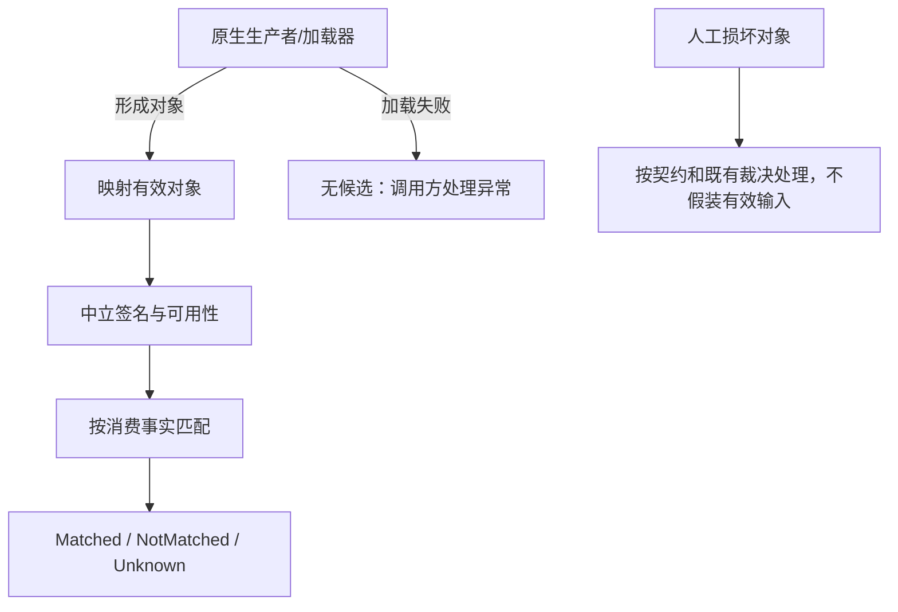

# CROSS-INPUT-001 有效输入、候选加载与人工损坏对象

<!-- aspectn-capability:v1
{
  "schema_version": 1,
  "id": "CROSS-INPUT-001",
  "title": "有效输入、候选加载与人工损坏对象",
  "category": "cross-cutting",
  "kind": "cross_cutting",
  "profile": "cross-cutting-v1",
  "norm_refs": [
    {
      "path": "docs/superpowers/specs/2026-07-31-aspectn-language-spec.md",
      "section": "5 / 21"
    },
    {
      "path": "docs/superpowers/specs/2026-07-31-aspectn-redesign-design.md",
      "section": "8 / 13"
    }
  ],
  "scenarios": [
    {
      "id": "S1",
      "adapter": "core",
      "input_mode": "neutral",
      "entry_point": "MethodSignature / PropertySignature / AttributeSignature 构造器",
      "conditions": "ParameterPositionTests 和 MetadataContractTests 的null集合/错误位置/索引输入",
      "target": "working-tree",
      "expected_behavior": "有效参数位置零起连续；构造器拒绝无效输入，不自动重排；人工中立默认Complete不是自动修复损坏数据",
      "contract_status": "supported",
      "verification_status": "verified",
      "verification_methods": [
        "automated"
      ],
      "evidence_ids": [
        "EV-20261014-001"
      ],
      "unverified_notes": ""
    },
    {
      "id": "S2",
      "adapter": "reflection",
      "input_mode": "native_member",
      "entry_point": "MethodInfo.GetParameters（进入适配器前）",
      "conditions": "CrossAdapterConformanceTests.GetParameters_MissingRuntimeDependency_CannotMaterializeReflectionCandidate 的隔离缺依赖程序集",
      "target": "working-tree",
      "expected_behavior": "加载器在形成参数Type前可失败；不是已经映射候选的Unknown结果，不用Cecil中立签名模拟此输入",
      "contract_status": "supported",
      "verification_status": "verified",
      "verification_methods": [
        "automated"
      ],
      "evidence_ids": [
        "EV-20261014-006"
      ],
      "unverified_notes": ""
    },
    {
      "id": "S3",
      "adapter": "cecil",
      "input_mode": "native_member",
      "entry_point": "Mapper.MapMethod / MapType",
      "conditions": "H1缺ReturnType/ElementType的人工构造Cecil对象；不属于有效生产者输入，未证明真实程序集可达",
      "target": "working-tree",
      "expected_behavior": "沿用维护者保留异常、不增加容错、不转换Unknown/Unsupported的裁决；本轮没有重新执行H1",
      "contract_status": "excluded",
      "verification_status": "unverified",
      "verification_methods": [
        "automated"
      ],
      "evidence_ids": [],
      "unverified_notes": "该具体输入尚无完整执行证据；不能外推已验证范围",
      "exclusion": {
        "reason_code": "out_of_scope",
        "reason": "对象已绕过生产者必需结构约束；当前契约不承诺修复任意损坏人工对象，保持既有接受风险处置",
        "decision_refs": [
          {
            "path": "docs/superpowers/specs/2026-07-31-aspectn-language-spec.md",
            "section": "5 / 21"
          },
          {
            "path": "docs/reviews/findings/FND-20261011-001.md",
            "section": "维护者裁决/H1"
          },
          {
            "path": "docs/superpowers/specs/2026-07-31-aspectn-redesign-design.md",
            "section": "8 / 13"
          }
        ],
        "failure_behavior": "沿用维护者保留异常、不增加容错、不转换Unknown/Unsupported的裁决；本轮没有重新执行H1"
      }
    }
  ],
  "invariant_checks": [
    {
      "invariant_id": "INVLOGIC",
      "applicability": "not_applicable",
      "condition_ref": {
        "path": "docs/knowledge/profiles.json",
        "section": "invariants/INVLOGIC"
      },
      "reason": "选定入口为中立构造器、Cecil 映射及候选 materialization，不进行三态匹配",
      "review_status": "confirmed",
      "reviewer": "/root/documentation_pilot_review",
      "reviewed_on": "2026-10-13"
    },
    {
      "invariant_id": "INVPARITY",
      "applicability": "not_applicable",
      "condition_ref": {
        "path": "docs/knowledge/profiles.json",
        "section": "invariants/INVPARITY"
      },
      "reason": "记录不同生产者的输入阶段，不把不同损坏对象或缺依赖情况作为同输入后端等价比较",
      "review_status": "confirmed",
      "reviewer": "/root/documentation_pilot_review",
      "reviewed_on": "2026-10-13"
    },
    {
      "invariant_id": "INVMISSING",
      "applicability": "applicable",
      "condition_ref": {
        "path": "docs/knowledge/profiles.json",
        "section": "invariants/INVMISSING"
      },
      "reason": "S2 的 Reflection GetParameters 查询可能缺失的依赖元数据；候选形成前传播加载器失败，不强制转为 Unknown，也不扩大 S1 或人工损坏 S3 的容错范围",
      "review_status": "confirmed",
      "reviewer": "/root/documentation_pilot_review",
      "reviewed_on": "2026-10-13"
    },
    {
      "invariant_id": "INVCANCEL",
      "applicability": "not_applicable",
      "condition_ref": {
        "path": "docs/knowledge/profiles.json",
        "section": "invariants/INVCANCEL"
      },
      "reason": "选定构造器、MapMethod 和 Reflection GetParameters 未声明 CancellationToken",
      "review_status": "confirmed",
      "reviewer": "/root/documentation_pilot_review",
      "reviewed_on": "2026-10-13"
    }
  ],
  "relations": [],
  "open_findings": [],
  "related_findings": [
    "FND-20261011-001"
  ]
}
-->

## 摘要

签名构造失败、原生候选无法加载、已有候选缺事实和人工损坏对象是四类不同输入，不能混写成统一Unknown能力。

## 契约

调用方须提供符合模型/生产者约束的输入。中立构造器可拒绝null集合、错误参数位置等无效对象；已有有效输入的不可用事实由可用性契约处理。H1沿用已批准不修复处置，不新增兜底契约。

## 输入条件

参数位置按声明顺序从零连续；被查询的成员/类型必须先能由对应原生API形成。修改内部堆/空掉必需类型指针等行为要单独证明真实可达性，不能用“同一个方法被调用”作等价输入证明。

## 分层能力

生产者/加载器负责原生对象形成，中立构造器负责结构约束；Mapper映射有效输入；Evaluator消费已形成的签名事实。阶段之前失败就没有可传给Match的候选。

## 阶段失败

参数构造ArgumentException/ArgumentNullException；Reflection候选加载缺依赖由加载器报错，本轮隔离测试断言FileNotFoundException；有效已映射输入的缺事实才按所需查询Unknown。H1不保证某个固定异常类型或统一异常通道。

## 例子与边界

```csharp
var parameter = new ParameterSignature("value", 1, typeUse);
// 放进方法参数集合的第零项，MethodSignature 构造时拒绝。
```

完整可运行例见[边界示例](../../../usage/examples/MatchingBoundaries/Program.cs)。若 `method.GetParameters()` 已因缺依赖失败，就不能声称“Mapper成功映射并返回Unknown”；跨适配器传入Cecil签名测到的是detached能力缺失，不是同一加载失败。



## 规范依据

架构第8、13节、已批准元数据可用性以及[H1裁决](../../../reviews/findings/FND-20261011-001.md)。本条目归档输入边界，不重新打开已接受风险。

## 实现与证据

[参数位置](../../../../tests/AspectN.Tests/Metadata/ParameterPositionTests.cs)、[真实候选加载缺依赖](../../../../tests/AspectN.Conformance.Tests/CrossAdapterConformanceTests.cs)。H1只有历史处置，本轮不登记假的修复证据。

## 关联与缺口

CROSS-AVAILABILITY-001处理已有签名缺事实，CROSS-RESOURCES-001处理合法结构超出上限。H1的真实程序集可达性仍是明确缺口；新增真实复现或契约变化才触发重评估。
