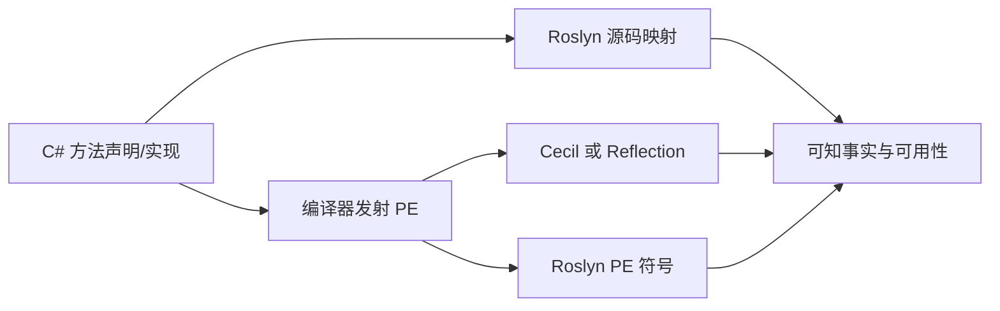

# CSH-METADATA-001 async、迭代器、partial 与源码/PE 边界

<!-- aspectn-capability:v1
{
  "schema_version": 1,
  "id": "CSH-METADATA-001",
  "title": "async、迭代器、partial 与源码/PE 边界",
  "category": "csharp-metadata",
  "kind": "feature",
  "profile": "feature-v1",
  "norm_refs": [
    {
      "path": "docs/superpowers/specs/2026-07-31-aspectn-language-spec.md",
      "section": "6 / 7 / 14"
    },
    {
      "path": "docs/superpowers/specs/2026-07-31-aspectn-redesign-design.md",
      "section": "9.1 / 9.2 / 9.3"
    },
    {
      "path": "docs/language/metadata-availability.md",
      "section": "Roslyn源码映射与后端分类覆盖范围"
    }
  ],
  "scenarios": [
    {
      "id": "S1",
      "adapter": "cecil",
      "input_mode": "native_member",
      "entry_point": "Mapper.MapMethod / attr / method(tasklike<...>)",
      "conditions": "MetadataConsistencyTests 的 async、普通 Task、async-iterator、局部 iterator 与 partial 实现 fixture；已发射 PE",
      "target": "working-tree",
      "expected_behavior": "IsAsync 和 tasklike 独立；实际记录与 partial 发射结果一致，局部 yield 不错误标记外层",
      "contract_status": "supported",
      "verification_status": "verified",
      "verification_methods": [
        "automated"
      ],
      "evidence_ids": [
        "EV-20261013-009"
      ],
      "unverified_notes": ""
    },
    {
      "id": "S2",
      "adapter": "reflection",
      "input_mode": "native_member",
      "entry_point": "Mapper.MapMethod / attr / method(tasklike<...>)",
      "conditions": "MetadataConsistencyTests 的 async、普通 Task、async-iterator、局部 iterator 与 partial 实现 fixture；已发射 PE",
      "target": "working-tree",
      "expected_behavior": "IsAsync 和 tasklike 独立；实际记录与 partial 发射结果一致，局部 yield 不错误标记外层",
      "contract_status": "supported",
      "verification_status": "verified",
      "verification_methods": [
        "automated"
      ],
      "evidence_ids": [
        "EV-20261013-009"
      ],
      "unverified_notes": ""
    },
    {
      "id": "S3",
      "adapter": "roslyn",
      "input_mode": "source_symbol",
      "entry_point": "Mapper.MapMethod / attr",
      "conditions": "同源符号、partial 声明/实现和方法语法入口的 MetadataConsistencyTests fixture",
      "target": "working-tree",
      "expected_behavior": "源码视图在对应标记类型存在时补编译器记录；partial 不合成发射时省略的标记，显式记录保留",
      "contract_status": "supported",
      "verification_status": "verified",
      "verification_methods": [
        "automated"
      ],
      "evidence_ids": [
        "EV-20261013-009"
      ],
      "unverified_notes": ""
    },
    {
      "id": "S4",
      "adapter": "roslyn",
      "input_mode": "pe_symbol",
      "entry_point": "Mapper.MapMethod",
      "conditions": "BackendBoundaryTests 的 CLI Event InvokeMethod=raise_E；仅当前 Roslyn PE 视图",
      "target": "working-tree",
      "expected_behavior": "当前视图缺 RaiseMethod 关联，raise_E 映射为 OrdinaryMethod，不能提供与 Cecil/Reflection 相同 EventRaiser 分类",
      "contract_status": "excluded",
      "verification_status": "verified",
      "verification_methods": [
        "automated"
      ],
      "evidence_ids": [
        "EV-20261013-009"
      ],
      "unverified_notes": "",
      "exclusion": {
        "reason_code": "backend_or_version_limit",
        "reason": "Roslyn PE 符号 API 不暴露该 CLI raiser 关联；已批准可用性契约保留原已明确的有效元数据后端分类边界",
        "decision_refs": [
          {
            "path": "docs/superpowers/specs/2026-07-31-aspectn-language-spec.md",
            "section": "6"
          },
          {
            "path": "docs/language/metadata-availability.md",
            "section": "保留原已明确的有效元数据分类覆盖边界"
          }
        ],
        "failure_behavior": "当前视图缺 RaiseMethod 关联，raise_E 映射为 OrdinaryMethod，不能提供与 Cecil/Reflection 相同 EventRaiser 分类"
      }
    },
    {
      "id": "S5",
      "adapter": "roslyn",
      "input_mode": "pe_symbol",
      "entry_point": "Mapper.MapMethod",
      "conditions": "BackendBoundaryTests 的 foreign op_AdditionAssignment；仅本次实际依赖版本和有效 IL，不外推未来版本",
      "target": "working-tree",
      "expected_behavior": "分类按 Roslyn 当前符号结果；Cecil/Reflection 保留 Operator；测试按所载 Roslyn 版本校验现有边界",
      "contract_status": "supported",
      "verification_status": "verified",
      "verification_methods": [
        "automated"
      ],
      "evidence_ids": [
        "EV-20261013-009"
      ],
      "unverified_notes": ""
    },
    {
      "id": "S6",
      "adapter": "cecil",
      "input_mode": "native_member",
      "entry_point": "Mapper.MapMethod / IsAsync / attr / tasklike",
      "conditions": "同PE的partial Async、AsyncIterator、显式MarkedAsync；原生成员；对照实际发射的状态机CA",
      "target": "working-tree",
      "expected_behavior": "未显式状态机CA的partial Async/AsyncIterator IsAsync为false，显式MarkedAsync为true；标记匹配按实际CA，Tasklike仅按返回形状",
      "contract_status": "supported",
      "verification_status": "verified",
      "verification_methods": [
        "automated"
      ],
      "evidence_ids": [
        "EV-20261013-018"
      ],
      "unverified_notes": ""
    },
    {
      "id": "S7",
      "adapter": "reflection",
      "input_mode": "native_member",
      "entry_point": "Mapper.MapMethod / IsAsync / attr / tasklike",
      "conditions": "同PE的partial Async、AsyncIterator、显式MarkedAsync；原生成员；对照实际发射的状态机CA",
      "target": "working-tree",
      "expected_behavior": "未显式状态机CA的partial Async/AsyncIterator IsAsync为false，显式MarkedAsync为true；标记匹配按实际CA，Tasklike仅按返回形状",
      "contract_status": "supported",
      "verification_status": "verified",
      "verification_methods": [
        "automated"
      ],
      "evidence_ids": [
        "EV-20261013-018"
      ],
      "unverified_notes": ""
    },
    {
      "id": "S8",
      "adapter": "roslyn",
      "input_mode": "source_symbol",
      "entry_point": "Mapper.MapMethod / IsAsync / attr / tasklike",
      "conditions": "同源partial Async、AsyncIterator、显式MarkedAsync；分别映射Roslyn源定义和PartialImplementationPart，对照原生IsAsync及直接记录",
      "target": "working-tree",
      "expected_behavior": "未显式标记时源定义IsAsync为false、源实现为true；显式MarkedAsync两者true；partial不补发射时省略的状态机记录，Tasklike仅按返回形状",
      "contract_status": "supported",
      "verification_status": "verified",
      "verification_methods": [
        "automated"
      ],
      "evidence_ids": [
        "EV-20261013-018"
      ],
      "unverified_notes": ""
    },
    {
      "id": "S9",
      "adapter": "roslyn",
      "input_mode": "pe_symbol",
      "entry_point": "Mapper.MapMethod / IsAsync / attr / tasklike",
      "conditions": "同PE的partial Async、AsyncIterator、显式MarkedAsync；Roslyn PE符号；对照实际发射的状态机CA",
      "target": "working-tree",
      "expected_behavior": "未显式状态机CA的partial Async/AsyncIterator IsAsync为false，显式MarkedAsync为true；标记匹配按实际CA，Tasklike仅按返回形状",
      "contract_status": "supported",
      "verification_status": "verified",
      "verification_methods": [
        "automated"
      ],
      "evidence_ids": [
        "EV-20261013-018"
      ],
      "unverified_notes": ""
    }
  ],
  "invariant_checks": [
    {
      "invariant_id": "INVLOGIC",
      "applicability": "applicable",
      "condition_ref": {
        "path": "docs/knowledge/profiles.json",
        "section": "invariants/INVLOGIC"
      },
      "reason": "条目包含匹配或关系结果，遵循三态组合；具体覆盖按场景",
      "review_status": "pending",
      "reviewer": null,
      "reviewed_on": null
    },
    {
      "invariant_id": "INVPARITY",
      "applicability": "applicable",
      "condition_ref": {
        "path": "docs/knowledge/profiles.json",
        "section": "invariants/INVPARITY"
      },
      "reason": "涉及适配器映射或关系时只比较同等输入和所需可用事实，不能外推缺失后端行",
      "review_status": "pending",
      "reviewer": null,
      "reviewed_on": null
    },
    {
      "invariant_id": "INVMISSING",
      "applicability": "applicable",
      "condition_ref": {
        "path": "docs/knowledge/profiles.json",
        "section": "invariants/INVMISSING"
      },
      "reason": "候选所需事实或原生关联可能不可用，不能把占位值当作确定事实",
      "review_status": "pending",
      "reviewer": null,
      "reviewed_on": null
    },
    {
      "invariant_id": "INVCANCEL",
      "applicability": "applicable",
      "condition_ref": {
        "path": "docs/knowledge/profiles.json",
        "section": "invariants/INVCANCEL"
      },
      "reason": "条目纳入完整匹配或公开关系入口，其 CancellationToken 必须按横向契约传播",
      "review_status": "pending",
      "reviewer": null,
      "reviewed_on": null
    }
  ],
  "relations": [
    {
      "type": "depends_on",
      "capability_id": "ATTR-TARGETS-001"
    },
    {
      "type": "depends_on",
      "capability_id": "USE-REF-001"
    }
  ],
  "open_findings": [],
  "related_findings": [
    "FND-20261013-004"
  ]
}
-->

## 摘要

C# 源语法、编译器发射记录和后端能观察的符号不是同一层。按具体视图描述已知事实，不用源码关键词代替签名。

## 契约

IsAsync保留具体输入视图可观察的async/异步迭代器信息，与是否返回Task不等同；partial源定义、源实现与发射PE可能不同，不承诺只凭字段恢复所有源码关键词。Roslyn 源码在类型存在时补 async/iterator/async-iterator 编译器 CA 记录；partial 按发射结果处理标记，显式记录仍保留。嵌套局部函数中的 yield 不改变外层方法的 iterator 属性。

## 输入条件

有效源码符号、方法语法和关联 Compilation，或有效 PE/运行时成员；缺依赖/错误符号单独按可用性处理。Cecil/Reflection PE 分类与 Roslyn PE 符号信息不足是不同条件。

## 分层能力

核心消费 IsAsync 和直接记录，不分析方法体。适配器负责源符号/PE 标志及编译器记录的统一。C# 语法关键词未自动扩展 Standard DSL；不存在 async/iterator/partial 选择修饰符。

## 阶段失败

把 async 当 DSL 修饰符会编译失败；任务类形状不判断方法体是否 await。CLI EventRaiser 的 Roslyn PE 边界不能扩展到正常 C# add/remove 访问器，也不等同整个事件功能排除。

## 例子与边界

```csharp
public Task<int> Cached() => Task.FromResult(1);
public async Task<int> Load() { await Task.Yield(); return 1; }
```

二者都可满足 `method(tasklike<int> *(..))`；仅后者具有编译器 async 标志。若源编译上下文没有状态机标记类型，不凭空合成该类型；partial 实现也不能据外层 async 词猜测实际记录。



## 规范依据

语言第 6、7、14 节、架构第 9 节和已批准[元数据可用性](../../../language/metadata-availability.md)。后端边界按当前实际依赖，不能自动推广到后续版本。

## 实现与证据

[源码/PE 一致性](../../../../tests/AspectN.Conformance.Tests/MetadataConsistencyTests.cs)、[CLI 后端边界](../../../../tests/AspectN.Conformance.Tests/BackendBoundaryTests.cs)。对同一输入按视图分场景，避免将源码和 PE 各自的结论混写。

## 关联与缺口

实际特性位置依 ATTR-TARGETS-001，引用标志依 USE-REF-001。Fody 的源码/PE 一致性没有由这些三后端 fixture 自动证明；未覆盖任意编译器生成方法或所有 Roslyn 历史版本。

本轮S6–S9实测partial视图：无显式状态机CA时，源实现IsAsync为true，但源定义及PE为false；直接标记记录与Tasklike分别按真实记录和返回形状匹配。Readonly返回CA身份遮蔽问题见[关联Finding](../../../reviews/findings/FND-20261013-004.md)。
