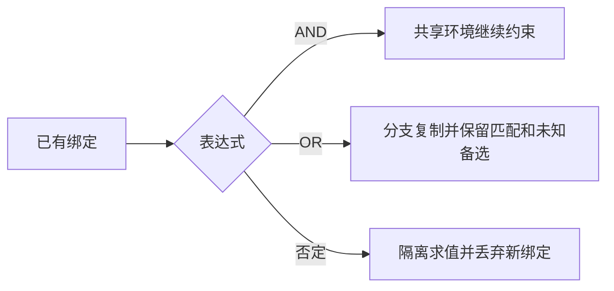

# GEN-BINDING-001 泛型元数、模式变量与作用域

<!-- aspectn-capability:v1
{
  "schema_version": 1,
  "id": "GEN-BINDING-001",
  "title": "泛型元数、模式变量与作用域",
  "category": "generics",
  "kind": "feature",
  "profile": "feature-v1",
  "norm_refs": [
    {
      "path": "docs/superpowers/specs/2026-07-31-aspectn-language-spec.md",
      "section": "7 / 13"
    }
  ],
  "scenarios": [
    {
      "id": "S1",
      "adapter": "core",
      "input_mode": "neutral",
      "entry_point": "Compile* / CompiledPattern.Match",
      "conditions": "GenericPatternTests、VariableDeclarationTests、PatternVariableTests、BindingAlternativesTests 的中立 fixture",
      "target": "working-tree",
      "expected_behavior": "省略具体名称子句是零元数；泛型子句声明 $变量；AND共享、OR隔离、否定不泄漏绑定；未知备选保持不确定",
      "contract_status": "supported",
      "verification_status": "verified",
      "verification_methods": [
        "automated"
      ],
      "evidence_ids": [
        "EV-20261014-001"
      ],
      "unverified_notes": ""
    },
    {
      "id": "S2",
      "adapter": "reflection",
      "input_mode": "native_member",
      "entry_point": "Mapper.MapMethod / CompiledMemberPattern.Match",
      "conditions": "GenericDefinitionMatchingTests 与 AssignablePatternMatchingTests 的开放/闭合、嵌套及备选绑定输入",
      "target": "working-tree",
      "expected_behavior": "形式形参可绑定变量；具体实参模式不误当定义形参；反射闭合查询依实际上下文",
      "contract_status": "supported",
      "verification_status": "verified",
      "verification_methods": [
        "automated"
      ],
      "evidence_ids": [
        "EV-20261014-005"
      ],
      "unverified_notes": ""
    },
    {
      "id": "S3",
      "adapter": "core",
      "input_mode": "neutral",
      "entry_point": "AspectNCompilation.Create",
      "conditions": "已执行未声明变量、否定首次声明及 OR 外引用错误输入",
      "target": "working-tree",
      "expected_behavior": "不能编译有效模式，并给变量作用域诊断",
      "contract_status": "excluded",
      "verification_status": "verified",
      "verification_methods": [
        "automated"
      ],
      "evidence_ids": [
        "EV-20261014-001"
      ],
      "unverified_notes": "",
      "exclusion": {
        "reason_code": "dsl_not_expressible",
        "reason": "变量需要明确的正向声明位置；否则没有唯一可复用绑定上下文",
        "decision_refs": [
          {
            "path": "docs/superpowers/specs/2026-07-31-aspectn-language-spec.md",
            "section": "13.2"
          }
        ],
        "failure_behavior": "不能编译有效模式，并给变量作用域诊断"
      }
    },
    {
      "id": "S4",
      "adapter": "core",
      "input_mode": "neutral",
      "entry_point": "NamedTypeSignature / MethodSignature 构造；CompiledPattern.Match",
      "conditions": "GenericSignatureValidationTests、IncompleteGenericArgumentTests：构造时校验实参/声明/原始定义元数，包含嵌套总元数、null及方法声明槽位；完整定义、开放/闭合构造及重复变量匹配作对照",
      "target": "working-tree",
      "expected_behavior": "槽位结构非法在构造时抛ArgumentException；合法定义和完整开放/闭合构造仍可匹配；无声明及原始定义的方法由实参确定元数",
      "contract_status": "supported",
      "verification_status": "verified",
      "verification_methods": [
        "automated"
      ],
      "evidence_ids": [
        "EV-20261020-002"
      ],
      "unverified_notes": ""
    }
  ],
  "invariant_checks": [
    {
      "invariant_id": "INVLOGIC",
      "applicability": "applicable",
      "condition_ref": {
        "path": "docs/knowledge/profiles.json",
        "section": "invariants/INVLOGIC"
      },
      "reason": "条目包含匹配或关系结果，遵循三态组合；具体覆盖按场景",
      "review_status": "pending",
      "reviewer": null,
      "reviewed_on": null
    },
    {
      "invariant_id": "INVPARITY",
      "applicability": "applicable",
      "condition_ref": {
        "path": "docs/knowledge/profiles.json",
        "section": "invariants/INVPARITY"
      },
      "reason": "涉及适配器映射或关系时只比较同等输入和所需可用事实，不能外推缺失后端行",
      "review_status": "pending",
      "reviewer": null,
      "reviewed_on": null
    },
    {
      "invariant_id": "INVMISSING",
      "applicability": "applicable",
      "condition_ref": {
        "path": "docs/knowledge/profiles.json",
        "section": "invariants/INVMISSING"
      },
      "reason": "候选所需事实或原生关联可能不可用，不能把占位值当作确定事实",
      "review_status": "pending",
      "reviewer": null,
      "reviewed_on": null
    },
    {
      "invariant_id": "INVCANCEL",
      "applicability": "applicable",
      "condition_ref": {
        "path": "docs/knowledge/profiles.json",
        "section": "invariants/INVCANCEL"
      },
      "reason": "条目纳入完整匹配或公开关系入口，其 CancellationToken 必须按横向契约传播",
      "review_status": "pending",
      "reviewer": null,
      "reviewed_on": null
    }
  ],
  "relations": [
    {
      "type": "depends_on",
      "capability_id": "GEN-IDENTITY-001"
    },
    {
      "type": "depends_on",
      "capability_id": "CROSS-LOGIC-001"
    }
  ],
  "open_findings": [],
  "related_findings": [
    "FND-20261013-002",
    "FND-20261020-002"
  ]
}
-->

## 摘要

泛型元数是语法约束，$变量是匹配时的声明与绑定；二者与 CLR 泛型参数声明身份分别治理。

## 契约

`Name`/`Name<!>` 要求零元数；`Name<>` 一个槽、`Name<,>` 两槽、`Name<..>` 正元数、`Name<?>` 任意元数。裸 `*` 是例外；加泛型子句的 `*<?>` 成为有名模式，不覆盖数组、形参或省略嵌套路径。

## 输入条件

泛型定义和槽位完整的构造类型都可作为候选；定义中的实际位置参数由模型确定。非空实参数量必须匹配声明元数，类型包含外层参数；原始定义不得与当前槽位矛盾。需要比较类型相等的变量操作依赖 ITypeSystem，未知不等同不相等。

## 分层能力

Binder 验证声明位置和可见作用域；Evaluator 每次匹配使用独立绑定环境。公开 MatchResult 不返回变量捕获；并发候选不会共享暂存绑定。

## 阶段失败

未声明引用、首次否定声明、泛型声明参数内否定变量或 OR 分支外首次使用会产生编译诊断。结构不合法的泛型签名在构造时抛 ArgumentException；完整槽位内的类型事实不可用仍按所需事实求值，不保证所有查询均为 Unknown。

## 例子与边界

```text
method($T Service.Convert<$T>($T))
System.Collections.Generic.List       // 只接受零元数，不匹配 List<int>
System.Collections.Generic.List<?>    // 任意元数
```

`method(T Service.Convert<T>(T))` 的 `T` 是字面类型名。声明类型和方法泛型子句先绑定，再检查返回/参数，不能用源码先后位置推断作用域。



## 规范依据

语言第 7、13 节；声明身份和闭合上下文另由已批准架构第 8.4 节约束。

## 实现与证据

[变量测试](../../../../tests/AspectN.Tests/Evaluation/PatternVariableTests.cs)、[备选测试](../../../../tests/AspectN.Tests/Evaluation/BindingAlternativesTests.cs)、[反射泛型定义](../../../../tests/AspectN.Reflection.Tests/GenericDefinitionMatchingTests.cs)。证据按条目场景定位。

## 关联与缺口

GEN-IDENTITY-001 定义 CLR 声明身份，CROSS-LOGIC-001 定义结果三态；逻辑真值表不单独证明变量环境合并。未穷举所有后端/泛型约束组合。

S4 现按 [2026-10-20 维护者裁决](../../../reviews/2026-10-20-c02-generic-signature-validation.md)在构造边界拒绝槽位结构非法的输入。[旧 Finding](../../../reviews/findings/FND-20261013-002.md)保留当时按缺失事实处理的历史结论，该结论不再定义当前输入范围。此为本次明确裁决，并非以修复缺陷为由自行将 supported 改为 excluded；H1 处置保持原范围。

[构造回归](../../../../tests/AspectN.Tests/Metadata/GenericSignatureValidationTests.cs)、[合法匹配对照](../../../../tests/AspectN.Tests/Evaluation/IncompleteGenericArgumentTests.cs)和[真实后端构造](../../../../tests/AspectN.Conformance.Tests/GenericSignatureConstructionTests.cs)记录当前证据；没有声明槽位及原始定义的方法仍可由完整实参列表确定元数。
